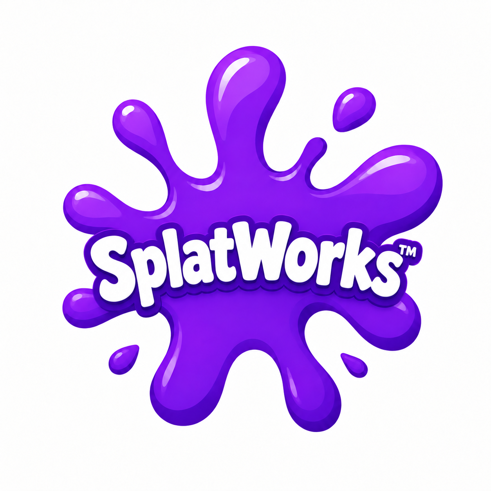
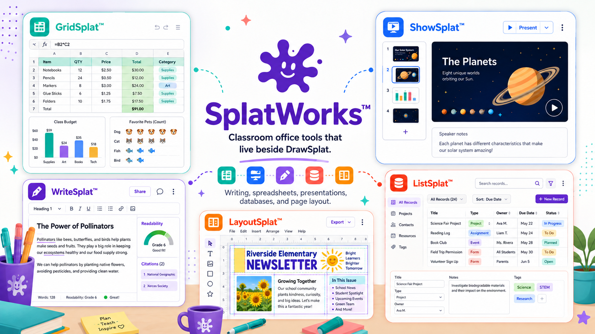

<p align="center">
  <a href="https://splatworks.org"></a>
</p>

# SplatWorks

**Create, teach, organize, and play in your browser.**

SplatWorks is the ecosystem behind the **DrawSplat whiteboard**, office applications, media editors, creation tools, classroom widgets, and games. Built for K–16 learning and everyday productivity, the tools offer multilingual interfaces and local file workflows, with optional connected services where supported.

This repository keeps its original **`mguhlin/drawsplat`** name. Existing DrawSplat links and file formats remain valid.

<p align="center">
  <a href="https://splatworks.org">Open SplatWorks</a> ·
  <a href="https://splatworks.org/studio/">Browse all apps</a> ·
  <a href="https://splatworks.org/wiki/">Read the wiki</a> ·
  <a href="https://splatworks.org/pages/download.html">Downloads</a> ·
  <a href="https://splatworks.org/docs/district-selfhost.html">District setup</a>
</p>



## Start here

Choose the task or role that brought you here, just as you would in the [SplatWorks Wiki](https://splatworks.org/wiki/).

| I want to… | Start with… |
| --- | --- |
| Explain an idea or build a classroom activity | [DrawSplat Whiteboard](https://splatworks.org/app/whiteboard.html) · [Teacher Quick Start](https://splatworks.org/guides/teacher-options-quick-start.html) |
| Find a tool by what it does | [Studio directory](https://splatworks.org/studio/) · [Ecosystem feature guide](https://splatworks.org/wiki/tools-widgets-features.html) |
| Write, present, organize records, or work with data | [SplatWorks office apps](#office-apps-and-planning) |
| Edit images, audio, or video | [Media and creation tools](#media-and-creation) |
| Practice typing or choose a classroom game | [Typing and games](#typing-and-games) |
| Set up a school or district installation | [Complete-suite Quick Start](https://splatworks.org/docs/district-selfhost.html) · [Technology admin guide](https://splatworks.org/wiki/for-technology-admins.html) |
| Help a student save work or get started | [Parents and students guide](https://splatworks.org/wiki/for-parents-and-students.html) |

**On this page:** [Explore](#explore-the-ecosystem) · [Office apps](#office-apps-and-planning) · [Media and creation](#media-and-creation) · [Teaching tools](#teaching-and-assessment) · [Games](#typing-and-games) · [Saving](#save-and-reopen-your-work) · [Installation](#run-or-self-host) · [Updates](#updates-and-release-history) · [Licensing](#licensing-and-user-content)

## Explore the ecosystem

| Area | What you can do | Open the guide |
| --- | --- | --- |
| **DrawSplat Whiteboard** | Draw, write, annotate, arrange panels, model thinking, and create classroom activities. | [Whiteboard feature reference](https://splatworks.org/guides/project-reference.html) |
| **Office apps and planner** | Create documents, slides, spreadsheets, databases, publications, and a study plan. | [SplatWorks overview](https://splatworks.org/pages/splatworks.html) |
| **Media and creation** | Record, edit, illustrate, caption, and export visual or audio explanations. | [Tools and widgets](https://splatworks.org/pages/tools.html) |
| **Teaching and assessment** | Build quizzes, flashcards, rubrics, diagrams, vocabulary activities, and classroom routines. | [Tools, widgets, and features](https://splatworks.org/wiki/tools-widgets-features.html) |
| **Typing and games** | Practice keys and passages, explore words, solve puzzles, and explain strategies. | [Game collection](https://splatworks.org/games/) |
| **School connections** | Configure supported accounts, storage, classrooms, assignments, turn-ins, and family access. | [District classrooms and rosters](https://splatworks.org/wiki/district-classrooms.html) |

The [Studio directory](https://splatworks.org/studio/) is the complete searchable catalog. Search by a task such as **“make slides,” “picture graph,” “edit video,”** or **“random picker.”**

## Office apps and planning

Five office applications work alongside the PlanSplat student planner.

| Application | Use it for | Help |
| --- | --- | --- |
| [**WriteSplat**](https://splatworks.org/splatworks/writesplat/) | Writing, formatting, classroom documents, readability, and document exchange. | [Writing guide](https://splatworks.org/wiki/writesplat.html) |
| [**ShowSplat**](https://splatworks.org/splatworks/showsplat/) | Slides, media, speaker notes, presentations, and portable WebDecks. | [Presentation guide](https://splatworks.org/pages/showsplat.html) |
| [**GridSplat**](https://splatworks.org/splatworks/gridsplat/) | Spreadsheets, formulas, classroom data, charts, and picture graphs. | [Spreadsheet guide](https://splatworks.org/pages/gridsplat.html) |
| [**ListSplat**](https://splatworks.org/splatworks/listsplat/) | Records, linked tables, forms, cards, reports, and classroom database projects. | [Database guide](https://splatworks.org/pages/listsplat.html) |
| [**LayoutSplat**](https://splatworks.org/splatworks/layoutsplat/) | Publications, newsletters, brochures, comics, labels, books, and ebooks. | [Layout and file guide](https://splatworks.org/wiki/layoutsplat.html) |
| [**PlanSplat**](https://splatworks.org/splatworks/plansplat/) | Assignments, exams, courses, study blocks, routines, and focus sessions. | [Planner guide](https://splatworks.org/wiki/plansplat.html) |

Keep original files when exchanging formats with other office software, and inspect the converted result. The [format comparison and limits](https://splatworks.org/wiki/faq.html#can-i-exchange-files-with-other-office-apps) explain what to expect.

## Media and creation

Choose a focused tool or combine a few tools around a project.

| Task | Tools to explore |
| --- | --- |
| Record a short video with illustrated panels | [ClipSplat](https://splatworks.org/solutions/clipsplat/) · [ClipSplat tutorial](https://splatworks.org/solutions/clipsplat/tutorial/) |
| Edit a video timeline and work with captions | [VideoSplat](https://splatworks.org/solutions/videosplat/) |
| Split, trim, or join audio and video | [MediaSplat](https://splatworks.org/solutions/mediasplat/) |
| Record and edit multitrack audio | [AudioSplat](https://splatworks.org/solutions/audiosplat/) |
| Edit, annotate, or adjust an image | [ImageSplat](https://splatworks.org/solutions/imagesplat/) |
| Remove or replace an image background | [BackdropSplat](https://splatworks.org/solutions/backdropsplat/) · [Background-removal guide](https://splatworks.org/wiki/backdropsplat.html) |
| Create lettering, image compositions, or animations | [FontSplat](https://splatworks.org/solutions/fontsplat/) · [GIFsplat](https://splatworks.org/solutions/gifsplat/) · [MemeSplat](https://splatworks.org/solutions/memesplat/) |
| Organize, annotate, or present a PDF | [PDFSplat](https://splatworks.org/solutions/pdfsplat/) |
| Write structured text or make a diagram | [MarkdownSplat](https://splatworks.org/solutions/markdown-studio/) · [ConceptSplat](https://splatworks.org/solutions/concept-map/) · [DiagramSplat](https://splatworks.org/solutions/mermaid/) |

**Generate import files with a chatbot:** the [AI JSON specifications](docs/ai-json-file-specifications.md) include exact fields, examples, reusable prompts, and media limits for supported tools. [How to use the specifications](https://splatworks.org/wiki/modular-selfhost.html#generate-import-files-with-an-ai-chatbot).

## Teaching and assessment

- **Make thinking visible:** use [DrawSplat](https://splatworks.org/app/whiteboard.html), [ConceptSplat](https://splatworks.org/solutions/concept-map/), and [DiagramSplat](https://splatworks.org/solutions/mermaid/) for models, explanations, and relationships.
- **Collect and respond to learning:** build [QuizSplat](https://splatworks.org/solutions/quiz-flashcard-studio/) quizzes and flashcards or a [RubricSplat](https://splatworks.org/solutions/rubric-builder/) scoring guide.
- **Explore mathematical evidence:** use [GraphSplat](https://splatworks.org/solutions/graphsplat/) for charts, picture graphs, coordinate plots, and function graphs, or GridSplat for a spreadsheet workflow.
- **Support classroom routines:** choose a timer, wheel, dice, bingo activity, or other utility from the [classroom tools guide](https://splatworks.org/guides/classroom-widgets-tools.html).
- **Start with a scaffold:** browse [background templates](https://splatworks.org/pages/background-templates.html), then adapt the prompt and response format for your learners.

For a complete classroom workflow, read [For educators](https://splatworks.org/wiki/for-educators.html) and [Collaboration and turn-ins](https://splatworks.org/guides/collaboration-turn-ins.html). Connected classroom features depend on the selected school setup.

### Professional learning with SplatLMS

[**SplatLMS**](https://github.com/mguhlin/splatlms) is a separate, PHP-based LMS product with **SplatWorks Educator** as its first course. The course combines ecosystem exploration with instructional strategies, practice, feedback, and classroom transfer. Its synthetic narrated slide overviews are optional and include captions and transcripts.

[SplatLMS introduction](https://mguhlin.github.io/splatlms/) · [Installer and releases](https://github.com/mguhlin/splatlms/releases/latest)

## Typing and games

The [Typing Games menu](https://splatworks.org/games/typing-games/) offers four distinct experiences.

| Experience | Practice focus |
| --- | --- |
| [**Paws & Keys Adventure**](https://splatworks.org/games/paws-and-keys-adventure/) | Gentle key practice and progressive trails, designed for ages 4–9. |
| [**Story Sprint**](https://splatworks.org/games/story-sprint/) | Passage typing with speed, accuracy, and character feedback; supports local classroom-text import. |
| [**Wordfall Reactor**](https://splatworks.org/games/wordfall-reactor/) | Word-board play with everyday words and optional subject vocabulary. |
| [**Cipher Chase**](https://splatworks.org/games/cipher-chase/) | Typing combined with steering and arcade-style vocabulary practice. |

Explore [Tangram Packing](https://splatworks.org/games/tangram/), [Lights Out](https://splatworks.org/games/lightsout/), [Flow Free](https://splatworks.org/games/flowfree/), [Untangle](https://splatworks.org/games/untangle/), and the [full game collection](https://splatworks.org/games/). [SplatBot Studio](https://splatworks.org/solutions/splatbot-studio/) adds sequencing and debugging with robot commands.

Preview reading demands, controls, timing, and themes for your learners. Pair practice with an explanation or transfer task when the purpose is subject learning. [Typing classroom walkthrough](https://splatworks.org/blog/typing-games.html).

## Save and reopen your work

1. **Keep an editable copy.** Export the app’s native project file so you can revise the work later.
2. **Check the finished export.** Reopen the image, document, presentation, or media output before sharing it.
3. **Treat browser drafts as device-specific.** Autosave belongs to the browser and domain where you worked. Clearing browser data can remove it.
4. **Use a connection deliberately.** Optional Google Drive or school storage follows the relevant app and deployment settings. A whiteboard classroom account does not automatically provide cloud saving for every app.

[Saving and exporting](https://splatworks.org/guides/saving-exporting.html) · [Google Drive: app formats and setup](https://splatworks.org/wiki/google-drive.html) · [Privacy controls](https://splatworks.org/privacy/)

SplatWorks.org and DrawSplat.org serve the same ecosystem. Browser drafts are separate on each domain; export a project to move work between them.

## Run or self-host

### Try the public apps

Open [SplatWorks.org](https://splatworks.org) or [DrawSplat.org](https://drawsplat.org). Many tools support browser-only work without creating an account. Some optional features need network access, authorization, or a configured school service.

### Serve a local copy

From the repository root, start a static server:

```bash
python3 -m http.server 8000
```

Visit `http://localhost:8000/` for the ecosystem homepage or `http://localhost:8000/app/whiteboard.html` for DrawSplat. No root npm installation is needed to serve the checked-in static apps. A local server avoids the restrictions that browsers apply to `file://` pages.

### Install for a school or district

Download the [complete district suite](https://splatworks.org/pages/download.html#district-suite), extract it, and open **`start-here.html`**. The Quick Start provides Docker and native installation paths, component choices, administrator setup, classrooms, backup, and recovery guidance.

| Deployment need | Guide |
| --- | --- |
| Complete suite with school accounts and classrooms | [District installation](https://splatworks.org/docs/district-selfhost.html) · [District source guide](docs/district-selfhost.md) |
| Individual static apps or selected component bundles | [Modular self-hosting](https://splatworks.org/wiki/modular-selfhost.html) |
| Browser-only whiteboard | [Browser setup](https://splatworks.org/wiki/setup-browser.html) |
| Google Apps Script, Drive, and Sheets | [Apps Script setup](https://splatworks.org/wiki/setup-google-apps-script.html) |
| Separately hosted MySQL/MariaDB service | [Database setup](https://splatworks.org/wiki/setup-mysql.html) · [Backend source](server/mysql-backend/README.md) |

Storage and collaboration capabilities differ between deployments. Use the current guide for your chosen setup, preserve `.assetsignore` / `.pagesignore` when deploying static assets, and keep server code, credentials, databases, and local development files outside the public asset upload.

## Documentation by audience

| Audience or question | Reference |
| --- | --- |
| Educators choosing an activity | [For educators](https://splatworks.org/wiki/for-educators.html) |
| Technology staff installing or maintaining the suite | [For technology admins](https://splatworks.org/wiki/for-technology-admins.html) |
| Families and students | [Parents and students](https://splatworks.org/wiki/for-parents-and-students.html) |
| Feature names, file workflows, and compatibility | [Feature directory](https://splatworks.org/wiki/tools-widgets-features.html) · [FAQ](https://splatworks.org/wiki/faq.html) |
| Student data, providers, retention, and district review | [Security, privacy, and terms](https://splatworks.org/legal/terms-privacy.html) |
| Accessibility | [Accessibility information](https://splatworks.org/legal/accessibility.html) |
| Software licensing and optional services | [Licensing](https://splatworks.org/wiki/licensing.html) · [Pricing and services](https://splatworks.org/pages/pricing.html) |
| Developer background and help | [About the developer](https://splatworks.org/wiki/about-developer.html) · [Contact](https://splatworks.org/pages/contact.html) |

## Updates and release history

The [download page](https://splatworks.org/pages/download.html) is the reference for current full-suite and independent-app packages. The [release notes](https://splatworks.org/pages/release-notes.html) and [blog](https://splatworks.org/blog/) explain recent changes without mixing the entire history into this introduction.

**Maintenance snapshot — October 31, 2026, v3.1.49:** PDFSplat adds clearer warnings that OCR covers are **not secure redaction**, plus a lower-memory mode. Review OCR spelling, accents, layout, and reading order. Four reviewed dependency patches are merged; major and sensitive upgrades remain held. [OCR and real-redaction workflow](docs/pdfsplat-ocr.md) · [Dependency review](docs/dependency-triage-2026-10-31.md).

<details>
<summary><strong>Looking for older release details or implementation notes?</strong></summary>

The former long README is preserved in [README-history.md](README-history.md). It includes dated changes, earlier terminology, legacy setup notes, and version history. Use the current wiki for present-day instructions.

- [Versioned release documents](docs/release-notes/)
- [GitHub release downloads](https://github.com/mguhlin/drawsplat/releases)
- [Support wiki maintenance](https://splatworks.org/wiki/support-wiki-maintenance.html)

</details>

## Repository guide

| Location | Contents |
| --- | --- |
| [`app/`](app/) | DrawSplat whiteboard entry point and application files. |
| [`splatworks/`](splatworks/) | Office apps and the PlanSplat planner. |
| [`solutions/`](solutions/) | Standalone media, creation, teaching, and productivity tools. |
| [`games/`](games/) | Typing adventures, puzzles, and other games. |
| [`wiki/`](wiki/) · [`guides/`](guides/) · [`docs/`](docs/) | Published guidance and technical source documentation. |
| [`data/drawsplat-tools.json`](data/drawsplat-tools.json) | Studio’s application and tool registry. |
| [`server/`](server/) | Optional backend implementations and deployment files. |
| [`scripts/`](scripts/) · [`tests/`](tests/) | Build, packaging, maintenance, and verification tools. |

## Licensing and user content

SplatWorks is an umbrella name; component licenses still apply.

- The DrawSplat whiteboard, standalone tools/widgets, and backends generally use **AGPL-3.0-or-later**, subject to component notices.
- **WriteSplat, GridSplat, ListSplat, ShowSplat, and LayoutSplat** use **GPL-3.0-only**. Follow each component’s bundled notices.
- Software use in schools and districts is free under the applicable open-source terms. Optional implementation, training, support, or custom-development services are separate.
- User-created boards, documents, student work, uploads, and exports belong to their respective authors or controlling organizations.

[License](LICENSE) · [Project notice and branding](NOTICE.md) · [Commercial terms](COMMERCIAL-LICENSE.md) · [Security reporting](SECURITY.md) · [Full licensing guide](https://splatworks.org/wiki/licensing.html)
