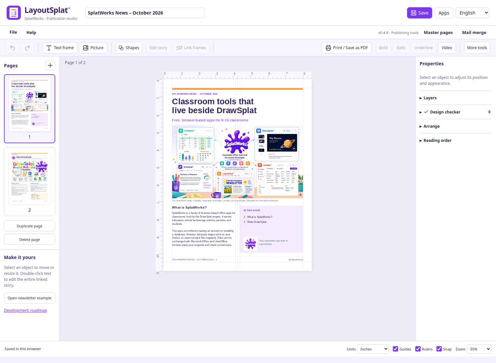

# Save your SplatWorks work to Google Drive

*October 15, 2026 · SplatWorks v3.1.41*

A PDF you annotated, a video you rendered, a concept map for tomorrow’s lesson: you can now save copies to your Google Drive directly from more SplatWorks apps. PDFSplat, VideoSplat, MediaSplat, MarkdownSplat, ConceptSplat and MermaidSplat join the five office apps and AudioSplat with optional Drive saving.

Your local download choices remain available. Choose Drive when you want a copy in the Google account you select, and check the app’s saved result before closing your work.

## Choose Drive, authorize, then check the saved copy

1. Choose the app’s **Save to Google Drive** action. Office apps and VideoSplat place their project action in the File menu; other tools have toolbar or output buttons.
2. Check the filename and choose **Save to Google Drive** in the dialog.
3. Authorize your Google account, then wait for the **Saved** result. Use **Open in Google Drive** to check the copy.

PDFSplat, VideoSplat and MediaSplat open a separate authorization window. Choose **Continue with Google** there and return to the original app for the transfer result. The project stays open in its editor.

The new [Google Drive wiki guide](../wiki/google-drive.html) puts every supported app, action and format in one place, with reopening steps, troubleshooting and district setup.

## Save the file you will need later

PDFSplat saves your edited PDF. MarkdownSplat saves `.md` source, ConceptSplat saves its complete editable JSON map, and MermaidSplat saves `.mmd` diagram source. MermaidSplat can also open that source locally with **Open .mmd**. Its existing SVG and PNG exports remain available.

VideoSplat offers two useful copies: the editable timeline’s `.videosplat.json` manifest, and the playable video after rendering. **A project manifest references its media; keep the original files and relink them when moving to another device.** A rendered video alone does not preserve the editable timeline.

MediaSplat can save a processed file, a ZIP of multiple outputs, or generated subtitles and transcripts as SRT and TXT. The five office apps save native projects; AudioSplat retains its Drive mix export.

Download a file from Drive and open it in its original app when you want to edit it again. These actions create file copies, rather than Google Docs, Sheets or Slides. Later edits need another save; Drive saving is not automatic synchronization.

## Try the two-page LayoutSplat newsletter

A fresh [LayoutSplat workspace](../layoutsplat/) now opens the first two pages of **SplatWorks News – October 2026**, with editable text and embedded illustrations. Existing saved publications still reopen first. Choose **File → Open starter newsletter** when you want a fresh copy, then use **File → Save to Google Drive** to keep a native project copy in your account.

## Your account, your choice

Direct Drive saving asks for access to files used with the app. The new actions do not enable sharing, and their tokens stay in tab memory. Cancelled or denied authorization leaves your local work available. School Workspace policies may restrict authorization; use the account and workflow your school approves.

Read the [Drive guide](../wiki/google-drive.html) for practical steps and [security, privacy and terms](../legal/terms-privacy.html) for the shared policy. Self-hosted districts configure their own OAuth client and site origin. The DrawSplat whiteboard’s Drive/Sheets rooms and turn-ins continue to use its separate Apps Script setup.

[Open the apps](../studio/) · [Google Drive guide](../wiki/google-drive.html) · [LayoutSplat guide](../wiki/layoutsplat.html) · [Release notes](../pages/release-notes.html) · [Downloads](../pages/download.html)
