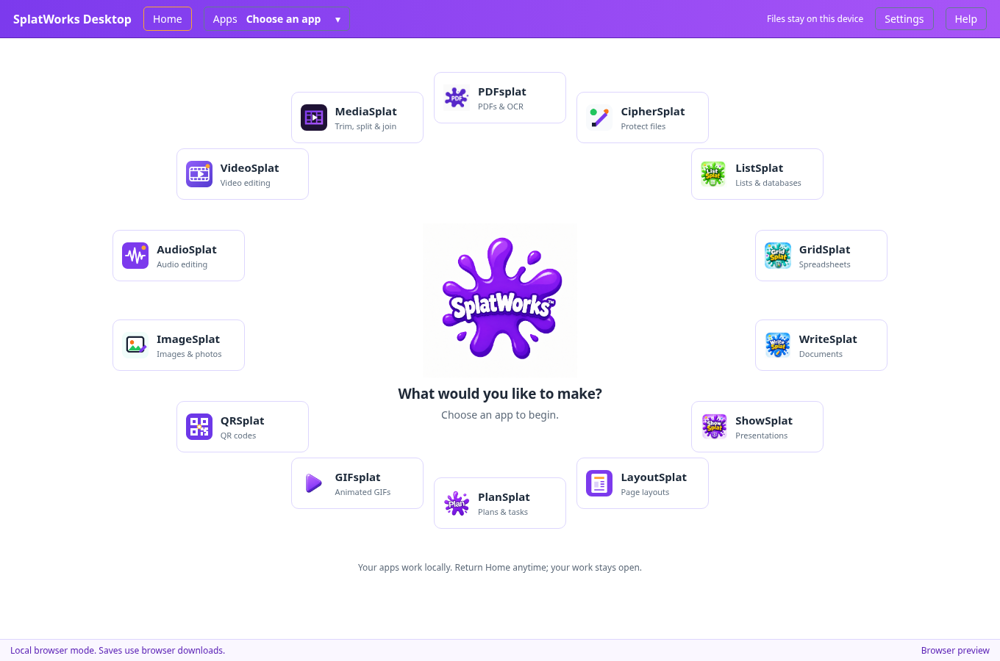

# SplatWorks: More Ways to Create, Better Protection for Your Work

**SplatWorks now gives you a fourteen-app desktop workspace, clearer recording controls, and stronger protection while you edit and save.** You can move from writing and planning to images, audio, video, and PDFs in one local application. The browser editions remain available, with recent improvements to classroom math and office-file handling.

Three changes matter most:

- **Make more in one workspace.** The desktop Home screen brings fourteen apps together and keeps their workspaces open as you switch.
- **Keep control of unfinished work.** Native saves, replacement warnings, and import checks help protect edits when something goes wrong.
- **Turn ideas into classroom materials.** Local image tools, portable media projects, and the browser’s Equation Studio give you more ways to explain and share.

Here is what those changes mean when you sit down to make something.

## Make more in one desktop workspace

SplatWorks Desktop opens on **Home**, with the SplatWorks logo surrounded by app choices. Choose a tool, return Home, and open another. Your existing workspace stays open, so you can prepare a handout, check a spreadsheet, and return to your draft without starting over.

<figure><figcaption>The fourteen-app Home chooser in a browser preview of the desktop interface. Installed editions use native save dialogs.</figcaption></figure>

The combined application includes:

- **Office and planning:** WriteSplat, GridSplat, ShowSplat, ListSplat, LayoutSplat, and PlanSplat.
- **PDFs and private files:** PDFsplat and CipherSplat.
- **Images and quick creations:** ImageSplat, GIFsplat, and QRSplat.
- **Audio and video:** AudioSplat, VideoSplat, and MediaSplat.

Office apps share a common color palette. Tool apps share a recognizable header and rainbow band. Each keeps its own menus, editing controls, and document colors.

The [desktop downloads](../pages/download.html#desktop-apps) support Windows, Mac, and Linux. Once installed with the required system runtimes, the bundled editing tools work offline without an account. Six smaller standalone apps are also available if you need just one tool. Their release is separate from the combined suite.

## Keep control of unfinished work

A workspace is useful only if you can trust the next save. The desktop suite uses native destination dialogs and reports success after the file has been written. Cancelling or failing a save leaves work available for another attempt. A completed save also leaves newer edits marked as unsaved.

Switching apps keeps your work in memory. Replacing a document or closing with unsaved changes requires a decision, and closing waits for active operations. Unfinished PlanSplat forms participate in those warnings, too.

**Save before you leave.** The desktop edition does not create automatic recovery copies. Keeping a workspace open is different from saving its file. Browser editions have their own browser-draft behavior; clearing browser data can remove those drafts.

Recent browser fixes also address two everyday office problems:

- **ListSplat checks project structure before import.** A malformed project is rejected before it can replace your open work or saved browser draft. A damaged draft no longer prevents startup.
- **GridSplat preserves merged cells when you clear values.** It also stops a sort through a merged region before changing data. Unmerge the affected cells before sorting that region.

Editable project files help you continue later. AudioSplat and VideoSplat save portable projects, and the office apps retain their existing native formats. Keep the original when converting Microsoft Office or LibreOffice files, then reopen and inspect the result. GridSplat projects preserve sheet data, formulas, and cell formatting; export chart images separately to preserve their appearance.

## Turn ideas into classroom materials

Consider a student preparing a short science explanation: clean up a photo, record a narration, assemble a video, and keep an editable copy. The expanded desktop suite puts those stages within reach of the same Home screen.

**ImageSplat includes the Fast background-removal model.** You can remove a photo background locally without fetching that default model on first use. GIFsplat creates animations, and QRSplat prepares codes for resources you want learners to open.

**VideoSplat makes recording setup clearer.** Choose a recording mode before optional camera and microphone setup. Denied access offers retry and system-settings guidance. Linux requests camera and microphone permission through a native prompt; the Debian package includes the required recording-plugin dependencies. VideoSplat chooses WebM or MP4 according to system support. Available capture modes still depend on the webview, codecs, permissions, and devices.

**MediaSplat handles focused finishing tasks.** Trim, split, join, transcribe, or burn subtitles, then save individual outputs or a ZIP. It accepts up to 256 MiB of source media and 512 MiB of outputs. Speech models are optional: explicitly enable online connections and obtain a model before using it offline. Connections start off in the desktop suite.

**GraphSplat’s Equation Studio adds another browser workflow.** Start with eight editable equation examples, enter LaTeX, or convert pasted spreadsheet cells into a LaTeX table. Export images, copy MathML or LaTeX, import supported `.tex` equations, or save Markdown, HTML, and complete LaTeX documents. Review the math and supply a meaningful description when sharing an image. [Explore Equation Studio and its limits](graphsplat-equation-studio.html).

## Start with one task

[Open a browser app](../studio/) to begin immediately, or [choose a desktop download](../pages/download.html#desktop-apps) for a local workspace. Try one small project, save its editable file, export the finished result, and reopen both.

The combined desktop download is **v1.0.0-rc.19**, an unsigned evaluation candidate. Publisher signing, Apple notarization, and physical-device qualification remain open. The [desktop guide](../wiki/desktop-apps.html) explains installation and saving; the [release notes](https://github.com/mguhlin/splatworks-desktop/releases/tag/v1.0.0-rc.19) describe the verified scope and remaining platform checks.

Use the browser editions for Google Drive and Calendar connections. Export a ShowSplat WebDeck to present in a browser. Review OCR text, and remember that PDF covers are visual edits rather than secure redaction.

For the next feature walkthrough or classroom lesson, [subscribe to the DrawSplat/SplatWorks RSS feed](drawsplat.rss).
