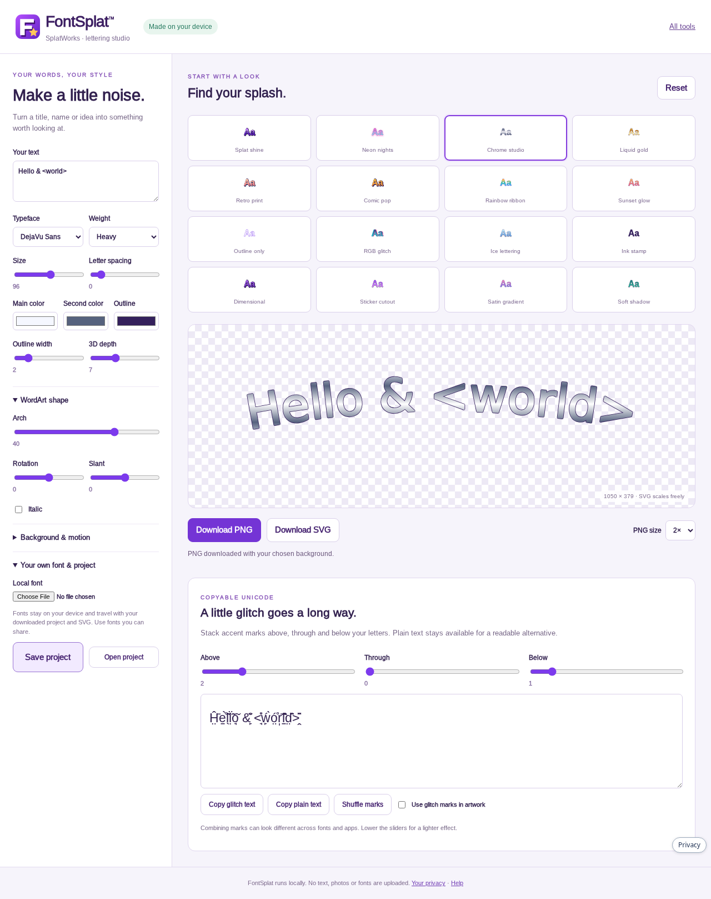
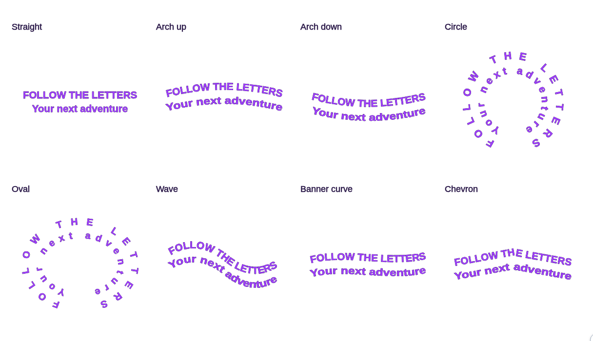

# FontSplat: lettering, SpellArt, and glitch text

Open [FontSplat](https://splatworks.org/fontsplat). Text and font files are
processed on your device. No generation account, external font service, or
text-upload backend is used.

Choose one of 22 original looks: Splat shine, Neon nights, Chrome studio,
Liquid gold, Retro print, Comic pop, Rainbow ribbon, Sunset glow, Outline only,
RGB glitch, Ice lettering, Ink stamp, Dimensional, Sticker cutout, Satin gradient,
Soft shadow, Blue burst, Spectrum serif, Golden rise, Silver press, Forest carved, or Swift outline. Change text, typeface, colors, weight, italic, letter spacing,
outline, depth, arch, rotation, and slant. Use up to eight text lines.

**Copy PNG** sends the current artwork directly to your clipboard, using the selected PNG size and preserving images and transparency. Paste it into a document, slide, email or image editor. Clipboard image writing requires a supported browser and clipboard permission; if it is unavailable or blocked, use Download PNG. The copy is a still image, even when pulse animation is enabled.

Download a PNG with a transparent or colored background at 1×, 2×, or 3×,
a scalable SVG with its typeface embedded, or an editable `.fontsplat.json`
project. SVG can optionally pulse its opacity; PNG and app insertions are still
images. Raster exports are limited to 16 megapixels. Custom font files are
limited to 6 MB; use fonts whose license allows embedding and sharing.

The Unicode glitch panel has separate Above, Through, and Below controls,
Shuffle marks, Copy glitch text, and Copy plain text. Enable Use glitch marks in
artwork to include those marks in PNG/SVG. Combining marks vary by font and
reader; lower the sliders for lighter lettering. Keep a plain-text description
for accessibility.

In LayoutSplat use the FontSplat · SpellArt toolbar button. In WriteSplat and
ImageSplat use Insert → FontSplat · SpellArt. The same editor opens inside the
app. Use in document inserts a PNG; it does not rewrite surrounding text.
WriteSplat/LayoutSplat retain the plain text as the picture description.
Save a FontSplat project to retain editable lettering controls separately.

The effects are original implementations. They do not call Cool Text or
FontGlitch APIs or include those services' artwork, fonts, or code.

## SpellArt shapes, pictures and motion

**SpellArt · bend lettering** provides actual text-on-path presets: Straight, Arch up, Arch down, Circle, Oval, Wave, Banner curve and Chevron. Letters rotate with the path; no filled shape is required. Each of up to eight text lines (400 characters) gets its own curve or concentric ring. Press Enter for another line. **Spread lettering to fill the path** distributes short text around the available path; long lines compress to avoid disappearing beyond its end. Circle/Oval offer a position slider that moves the lettering around the ring without cutting off the beginning or end. The custom arch slider remains available for a manual bend with the Straight preset.

Six additional classic-inspired styles offer bright blue extrusion, multicolor serif lettering, rising gold, slanted metallic silver, carved green and italic outlines. They combine with the selected path. These are original FontSplat implementations rather than imported Microsoft artwork.

**Optional background badge** separately retains the old filled banner, ribbon, oval, circle, badge and rounded backplates, with independent fill/edge colors. Previously saved projects keep those choices. New projects use no background badge. Lettering paths and all style choices travel in saved projects, SVG, PNG and pulse animation exports.

Use **Add image**, drop pictures onto the preview, or paste a clipboard picture while the preview is focused. Up to six PNG/JPEG/WebP/GIF pictures can be added; GIF input uses a still frame. Imports are rasterized locally and reduced to a maximum 2048-pixel edge. Choose a picture, drag it in the preview, or adjust horizontal/vertical position, width, opacity, rotation and layer. Choose “In front” to place it above the text/shape. Pictures embed in project files, PNG and SVG exports. Project loading validates local raster data and limits embedded sizes; SVG picture uploads and remote image URLs are not accepted.

**Animated GIF** prepares a two-second looping pulse with a preview and download link. **MP4 video** renders three pulse cycles (six seconds) as H.264/yuv420p video with the selected background color. It loads the bundled FFmpeg converter only when requested. Both render locally, retain picture layers and shapes, and pulse the text from full opacity to 60% and back. Motion exports fit within a 960-pixel edge and 600,000 pixels per frame. GIF uses indexed colors and ordered transparency dithering to approximate partial opacity; choose a solid background for smoother GIF edges. MP4 has no alpha channel. PNG and document insertions remain still images; SVG retains its pulse animation. Cancel is available while encoding.

## Remove image backgrounds and place arched captions

**Auto-remove plain backgrounds on import** is on by default. It detects an edge-connected white, black or dominant plain backdrop, including an opaque white rectangle inside an already transparent PNG. Removal runs in a local worker. Similar near-white shades are grouped to handle compressed images; enclosed white areas, such as eyes inside a colored face, stay intact. Clear margins are trimmed after removal.

Turn that option off to keep new pictures unchanged. For a selected picture, **Remove background** offers automatic detection, White, Black or Chosen color, with a tolerance slider. **Restore original** restores pictures changed during the current session; original copies are not added to downloaded projects. Cutout pixels embed in saved projects and all artwork exports. This is plain-color background removal, not subject segmentation for complex photographs. If the backdrop is not confidently detected, automatic import keeps the original and offers the manual color choices.

Under **Lettering around the picture**, choose **Arch above**, **Arch below**, or **Above & below**. The layout centers and sizes the picture, places real arched lettering outside it, and expands the output canvas. Above & below provides a separate lower-caption box, supporting four lines / 200 characters. Use **Space between lettering and picture** to separate the captions or overlap them slightly; the existing size, color, style and picture controls remain available. **Free placement** returns to the original composition controls. Layout, gap and lower-caption text survive project saving, and PNG, SVG, GIF and MP4 exports retain the composition.
