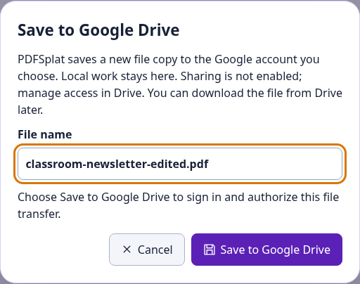

# Save to Google Drive

Keep a file copy in your Google Drive from the SplatWorks office apps and creative tools. Drive saving is optional: local downloads and existing browser drafts remain available. These saves create files in Drive; they do not convert your work into Google Docs, Sheets or Slides, or automatically sync later edits.

## Save your work

1. Open an app and create or open your work. In PDFSplat, open a PDF first; in MediaSplat, process a file first.
2. Choose the Drive action listed below.
3. Check the filename and choose **Save to Google Drive**.
4. Choose your Google account and allow the requested access. **PDFSplat, VideoSplat and MediaSplat open a separate authorization window:** choose **Continue with Google** there, complete sign-in, then return to the original app tab.
5. Wait for the app’s **Saved** result. **Open in Google Drive** lets you check the saved copy. Editing afterward requires another save for an updated copy.

*The file stays open in its app while you authorize the save. Allow the authorization popup if your browser blocks it.*

## Apps, actions and formats

| App | Where to save | What Drive receives |
| --- | --- | --- |
| WriteSplat, ShowSplat, ListSplat, LayoutSplat | **File → Save to Google Drive** | A native editable project copy. |
| GridSplat | **File → Save → Save Google Drive** | A native editable spreadsheet project. **File → Open → Open Google Drive** reopens its last Drive save from this browser. |
| PDFSplat | **Save PDF to Google Drive** in the toolbar | A PDF with the current edits and page arrangement. |
| VideoSplat | **File → Save project to Google Drive** | A `.videosplat.json` timeline manifest. It references media; keep the originals and relink them when moving to another device. |
| VideoSplat rendered video | **Export video**, render, then **Save video to Google Drive** | The rendered playable video, separate from the editable project manifest. |
| MediaSplat | **Save to Google Drive** beside a processed output; **Save all to Google Drive** for multiple outputs | The processed file, or a ZIP containing the output files. Generated subtitles and transcripts also have SRT and TXT Drive saves. |
| MarkdownSplat | **Save to Google Drive** in the toolbar | Editable `.md` source. |
| ConceptSplat | **Save As → Google Drive**, or the File menu’s Drive action | An editable `.drawsplat-cmap.json` map, including groups, connectors and embedded images. |
| MermaidSplat (DiagramSplat in the app) | **Save to Google Drive** | Editable `.mmd` diagram source. SVG and PNG downloads remain available. |
| AudioSplat | Its existing Google Drive mix export | An audio mix. AudioSplat’s optional sharing choice is separate from saving. |

**Reopen a saved copy:** download the file from Drive, then open or import it in the corresponding app. MermaidSplat has **Open .mmd**. A rendered video or output ZIP contains exported results; keep the native project and source media when you need further editing.

The DrawSplat whiteboard’s Google Drive/Sheets saving, rooms and turn-ins use its separate [Apps Script setup](../guides/google-setup.html). You do not need to deploy Apps Script for the direct saves listed above.

## Privacy and school accounts

Google sign-in loads after you choose Drive. The direct saves request `drive.file` access to files used with the app. Their access tokens stay in tab memory. The separate authorization page receives no project content. Cancelling or denying permission leaves your local work available; the new save actions do not enable sharing. Manage access in Google Drive.

If optional connections are off, open [Privacy](../privacy/) and enable them before saving to Drive. School Workspace administrators can restrict Google authorization, so use the account and workflow your school approves. [Security, privacy and terms](../legal/terms-privacy.html#google-oauth-disclosure) covers Google access and district review.

## Troubleshooting

- **Popup blocked:** allow the authorization window for the site, then retry the Drive save.
- **Permission denied or sign-in closed:** your work stays open. Retry or use the local download.
- **Transfer interrupted:** retry when connected. Large files use resumable upload transport, but an interrupted save may need to start again. Check Drive for any completed copy before retrying.
- **Different device or domain:** browser drafts do not move automatically. Download the Drive file and open it in the appropriate app. VideoSplat manifests also need their original media.
- **`origin_mismatch`:** a self-hosted OAuth client must register the exact origin used in the address bar, including protocol and any port. Origins contain no app path.

## District and self-hosted setup

Local editing needs no Google configuration. The public SplatWorks.org and DrawSplat.org sites use the configured public client. A district’s own host needs its own OAuth web client:

1. In the district’s Google Cloud project, enable the **Google Drive API** and configure the OAuth audience/consent settings for the intended users.
2. Under **APIs & Services → Credentials**, open the OAuth client of type **Web application**. Add the exact site under **Authorized JavaScript origins** and save. Use the host’s HTTPS origin; for localhost testing, register both `http://localhost` and `http://localhost:PORT` as Google’s setup guide requires. Keep any other required origins.
3. Add `<meta name="google-drive-client-id" content="YOUR_CLIENT_ID.apps.googleusercontent.com">` before the app scripts in each app’s `index.html`. Retain it in `index.vite.html` when rebuilding Vite apps. GridSplat also supports `VITE_GOOGLE_DRIVE_CLIENT_ID`; AudioSplat retains its own build-time client setting. A client ID is public configuration; never distribute a client secret.
4. Deploy the included `splatworks/shared/` folder. For PDFSplat, VideoSplat and MediaSplat, retain the editors’ isolation headers. Give `/splatworks/shared/google-drive-auth` and its `.html` form `Cross-Origin-Opener-Policy: same-origin-allow-popups` and `Cross-Origin-Embedder-Policy: unsafe-none`.
5. For Cloudflare Pages, use the [current `_headers` file](https://github.com/mguhlin/drawsplat/blob/main/_headers) from the source repository, including when deploying an extracted ZIP. Configure equivalent rules on other servers. Allow Google Drive API connections from the editor and Google identity scripts/frames on the authorization page. Test using a permitted school account before student rollout.

See [Google’s OAuth client setup](https://developers.google.com/identity/oauth2/web/guides/get-google-api-clientid), [modular hosting](../wiki/modular-selfhost.html) and [district installation](../docs/district-selfhost.html).
