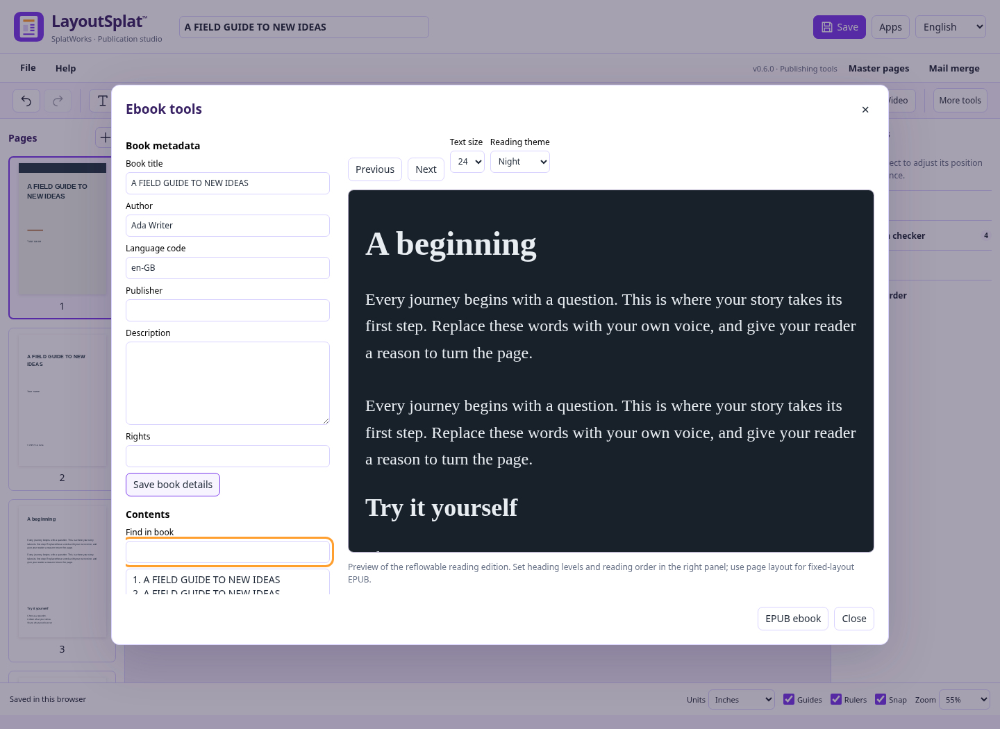
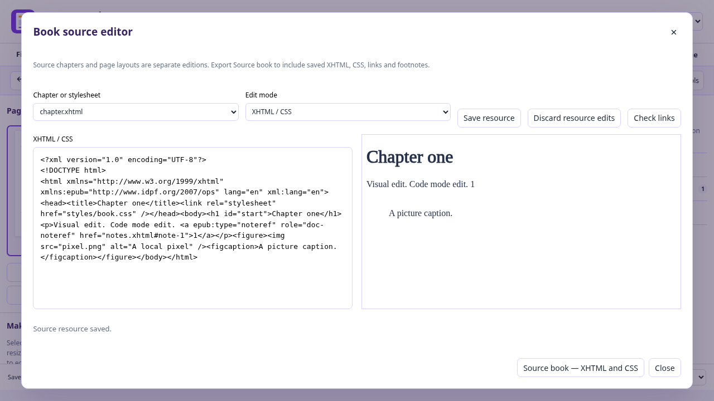
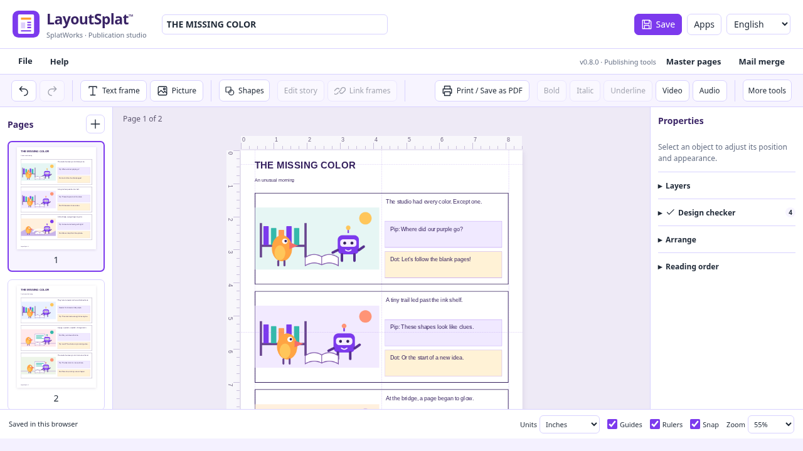
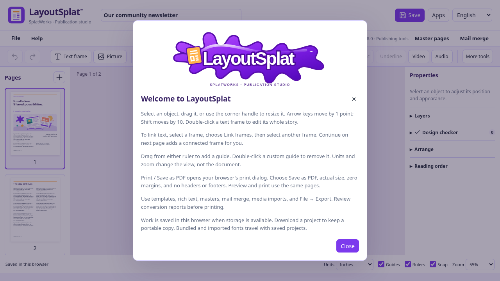

# LayoutSplat · Ebooks and EPUB

LayoutSplat v0.8.0 creates EPUB 3 ebooks and imports supported EPUB 2/3 books
locally. Open **File → Templates → Ebooks** for three original, editable starters:
**The Quiet Journey** (novel), **A Field Guide to New Ideas** (nonfiction), and
**Small Wonders** (illustrated story). Each has a cover, title page and two
chapter pages, with language-specific headings and neutral lorem ipsum body copy.

## Write and organize

Edit stories with the existing visual rich-text editor and replace illustrations
with your own pictures. In the right panel's **Reading order**, select a text
item and choose an **Ebook heading** level (H1–H6), or Body text. Mark chapter
titles as H1 and subsections as H2/H3. The EPUB contents navigation uses these
headings; source page sections provide fallback navigation when headings are absent.
Earlier/Later changes reading order without moving the page artwork. Omit from
reading edition excludes an item from reflowable EPUB and reading HTML.

**File → Ebook tools** opens book title, author, language code, publisher,
description and rights. **Save book details** saves them into the native project
and supports undo. Use a language code such as `en`, `es`, `vi`, `ar`, `zh` or
`hi`; the publication's Hindi UI identifier is converted to `hi` automatically.
Save the `.layoutsplat` project to preserve these details and complete editing.

The ebook workspace combines a searchable contents outline with a reading
preview. Select a section or use Previous/Next, choose 16–28 pixel text, and
switch Paper/Sepia/Night themes. **Edit selected text** returns to the page and
opens its first editable reading story. Reading themes and size affect preview;
the exported ebook remains adjustable in the reader. The preview is isolated
and does not run book scripts or load external resources.

## Export

Choose **File → Export → EPUB ebook**. Set a page range, or leave it blank for
all pages, then choose the ebook layout and Download.

| Layout | Content | Best suited to |
| --- | --- | --- |
| Reflowable | Selectable rich text, packaged pictures, tables, audio and video in reading order; heading navigation | Novels, guides and text-led books |
| Source book | Saved XHTML/CSS, local fonts, images, supported audio/video, chapter links, footnotes and imported navigation | Editing an imported EPUB without rebuilding its source structure |
| Fixed layout | Each selected page becomes a PNG picture at the chosen resolution, with EPUB page dimensions and playable audio/video overlays | Illustrated books and exact page compositions |

Reflowable EPUB includes each linked story once and includes its complete text,
including text that overflows its page frames. Selecting a page containing a
continuation frame therefore includes that whole story. Decorative shapes and
master-page furniture are omitted. Pictures use their embedded source image;
page crops, masks, overlapping artwork and image effects are not reproduced in
the reading edition. Audio and video are embedded with playback controls. Fonts are not embedded.
Readers choose fonts, type size and page breaks. Review reading order and picture
descriptions in Ebook tools before publishing.

Fixed-layout EPUB retains page appearance as pictures. Its text is not selectable
or individually editable. An unchanged exported EPUB reimports as picture pages;
use the native `.layoutsplat` project for editable text and objects. Bleed, crop
marks and ICC profiles do not apply to EPUB output.

The page-derived layouts contain EPUB package metadata, a manifest, spine, XHTML contents
navigation and an NCX fallback. Reflowable navigation includes nested heading
links. No native project or original Publisher source is embedded in an EPUB.
The package follows the [W3C EPUB 3.3 specification](https://www.w3.org/TR/epub-33/).
Check the book in the readers you intend to support; package validation does not
certify accessibility or bookstore acceptance.

## Import

Choose **File → Import → EPUB — ebook text and pictures**, or choose an EPUB
through Open LayoutSplat project. Unencrypted EPUB 2/3 content is read in spine
order. Supported text becomes native stories with linked continuation frames;
headings, basic bold/italic/underline, supported CSS text styles and external
HTTP(S)/email links remain editable. Packaged images become native image objects.
Text before and after an inline picture keeps its reading order. Table cell text
becomes paragraphs. Book metadata is retained.

Import creates two editions. The **page edition** repaginates supported text and pictures into editable frames. The **source edition**, available for supported reflowable XHTML books, separately retains sanitized XHTML, supported CSS, local pictures, unencrypted fonts, IDs, links, footnote/endnote markup, nonlinear chapters and imported EPUB 3 navigation. Page edits and source edits are independent; choose the corresponding edition at export. Original complex CSS can render differently between readers.

Single-picture fixed-layout pages retain their appearance. Other fixed-layout text repaginates; fixed-layout imports do not create a source edition. Scripts, forms, SVG/MathML source content and remote resources are omitted. Page-canvas import omits audio/video playback; supported local media are retained in the separate source edition. SMIL synchronized media overlays are not supported. DRM content is rejected; only the specific encrypted/obfuscated font resources are excluded. Missing required chapters or invalid markup leave the current publication intact. Local CSS imports are expanded with depth/size limits; remote imports are discarded. Source capture can be unavailable for books outside the supported subset; the conversion report explains this.

## Edit the source edition

Open **File → Ebook tools → Book source editor**. For an existing page publication, LayoutSplat first creates a source edition from its reading export. Choose a chapter or stylesheet, edit **XHTML / CSS**, then choose **Save resource**. Chapter markup must be well-formed XHTML with unique IDs; invalid changes leave the saved resource intact and keep the editor open. **Visual chapter** lets you edit the chapter body in an isolated preview. Switching resources/modes or closing saves valid pending edits. **Discard resource edits** restores the saved resource. Native save, recovery and undo retain source resources.

**Check links** checks packaged paths and fragment IDs, including links to nonlinear footnotes and backlinks. Preview clicks can move between chapters. External links are retained in the exported book but disabled in the preview; the preview cannot execute scripts or load network resources. Source CSS uses a supported property/rule allowlist, not every browser CSS feature. Source import retains the original EPUB 3 navigation document when present; otherwise source export generates chapter navigation. EPUB 2 NCX-only contents are rebuilt from source chapters.

Choose **Source book — XHTML and CSS** in EPUB export to include saved source edits. It exports the complete source book; page-range, ppi, bleed and ICC controls do not apply. Unsaved page-canvas changes are not copied into this edition.

The source edition preserves supported semantic note markup; it does not provide an annotation database or synchronized narration editor. EPUBCheck and link checks do not certify accessibility or bookstore acceptance.

Import limits: 96 MB compressed file, 5,000 archive entries, 8 MB per XML/XHTML
component, 2 MB per stylesheet, two million total text characters, 100,000
characters per native story, 500 publication pages and 500 pictures. Very large
individual paragraphs or unusually elaborate styling can exceed native story
range limits; split those chapters in an EPUB editor first. Export allows up to
128 MB of embedded pictures and the app's existing page image limits.

## Related ebook workflows

The book metadata, heading navigation and visual editing workflow draws on useful
patterns from [Sigil](https://sigil-ebook.com/about/) and
[PageEdit](https://sigil-ebook.com/pageedit/). Reader controls draw on patterns in
[epub.js](https://github.com/futurepress/epub.js),
[Foliate.js](https://github.com/johnfactotum/foliate-js) and
[InkWeave](https://github.com/mengmopqje/inkweave). This implementation uses
LayoutSplat's existing editor and local ZIP/markup tooling; it does not bundle
those applications or copy their implementation. LayoutSplat now includes its own XHTML/CSS and visual chapter editing. Sigil/PageEdit remain useful for advanced ebook workflows; independent acceptance evidence is recorded in [release verification](layoutsplat-verification.md).

## Enhanced ebooks and comics (v0.8.0)

Use the Audio or Video toolbar button, or File → Import → Images, audio & video.
Files are processed locally. MP3/M4A audio is retained; other supported audio
formats are converted locally to MP3. Video uses the existing local MP4
conversion when necessary. Add a useful description in Picture description and
include captions or a transcript in a text frame.

Both EPUB layouts package audio/video inside the book with playback controls.
Fixed layout overlays the player at its page-frame position. Ebook tools
previews the playable reading edition. HTML includes players; print/PDF and
layout-exchange formats keep the poster or audio card. No autoplay is added.
Playback and codec support vary by reader: test in your audience's reader.
EPUB export limits the combined picture/media payload to 128 MB. Imported
source-book resources keep the existing 16 MB per-resource limit. Source-book
export retains local MP3/M4A, supported video and WebVTT without scripts or
remote loads.

File → Templates → Comics & panel layouts offers two original two-page samples,
The Missing Color and Signal from the Library, plus six blank layouts: six-panel,
nine-panel, hero splash, four-panel, horizontal strip and vertical story.
Captions, dialogue, panels and pictures remain editable. The sample stories are
in English; their original artwork and copy are offered under CC0 for reuse.
Panel templates contain lorem ipsum. Fixed-layout EPUB preserves panel placement;
use reading order for a text-led edition.

The new stock illustration is the original LayoutSplat idea studio. Generic body
areas use lorem ipsum; headings, contact merge fields, menus and completed comic
stories keep their purpose. Saved user projects are not rewritten. Welcome uses
the LayoutSplat SplatWorks-style mark and omits the development-roadmap link.

Both https://splatworks.org/layoutsplat and https://drawsplat.org/layoutsplat
redirect to the app on the same domain; browser workspaces remain origin-local.

Validation: 29 targeted Chromium workflows, all 134 templates in six language
settings without text overflow, model tests, and seven independent EPUBCheck
proofs including embedded-media reflowable/fixed/source books passed.

[EPUB multimedia and fallback requirements](https://www.w3.org/TR/epub-33/#sec-fallback-processing-flow)

