# LayoutSplat: illustrated feature guide

**Version reviewed: 0.5.0 · Updated October 16, 2026**

[Open LayoutSplat](https://splatworks.org/layoutsplat/) · [Technical reference](https://splatworks.org/wiki/layoutsplat.html) · [Import accuracy](https://splatworks.org/wiki/layoutsplat-import-accuracy.html)

LayoutSplat™ is the SplatWorks™ ecosystem’s page-layout application. It combines editable page objects, rich text stories, original publication templates, local file conversion, personalized output, and print preparation. The workspace screenshots show v0.4.6; the Publisher export screenshot shows v0.6.0. They use bundled or synthetic publications in clean browser contexts.

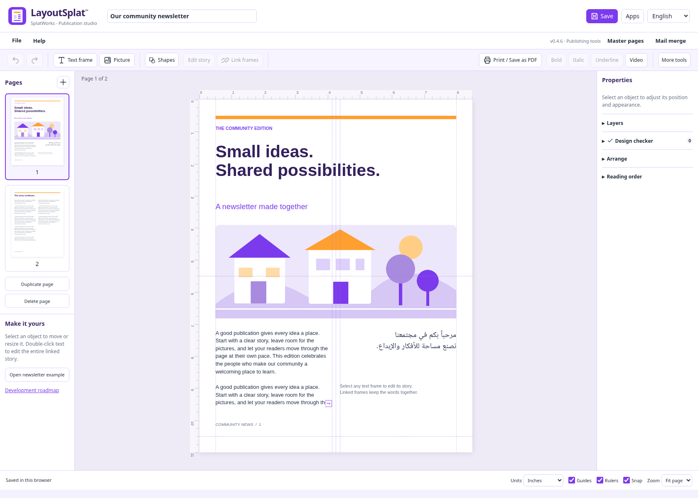

*The workspace separates page navigation, the publication canvas, and object properties. Rulers and guides surround the page; layers, reading order, and checker findings use the right panel.*

## 1. Starting a publication and navigating the workspace

- Start with a blank publication, the newsletter example, a template, or a supported imported document.
- Use page thumbnails to navigate; add, duplicate, or delete pages.
- Adjust the project title independently of page text.
- Zoom to a percentage or fit the whole page. Show/hide rulers and guides and enable snapping.
- Use undo and redo during editing.
- Switch the interface language using the shared language picker. Publication-language editions in the library are a separate choice.
- Open other tools from the Apps launcher.

The organized **File** menu contains project commands, Templates, alphabetized Import choices, Page layout, Preview, Print / Save as PDF, label alignment, Design checker, Export, and Clear saved browser data. Master pages and Mail merge also have top-level controls.

## 2. Original editable publication templates

**File → Templates → Browse all designs** opens **126 distinct compositions across 19 publication types**. Filter by type, industry, orientation, language, palette, or search. Industry and palette are customizations; they are not counted as extra designs.

| Publication type | Examples and supported starting points |
| --- | --- |
| Flyers | Eight compositions; two include ten vertical name/phone tear-off tabs and dotted cutting lines. |
| Brochures | Eight compositions: four trifolds and four bifolds, with outside and inside pages. |
| Newsletters | Six different compositions for multipage stories and announcements. |
| Business cards | Six two-sided 3.5 × 2 inch designs with replaceable logo examples. |
| Catalogs | Product and collection layouts with editable pictures and descriptions. |
| Greeting cards | Folded message and illustration layouts. |
| Labels | Measured Avery sheets for address, shipping, return, file-folder and related uses; name badges are in this section. |
| Postcards | Compact front/back communication layouts. |
| Posters | Larger announcement and display compositions. |
| Letterhead | Branded correspondence starting points. |
| Rack cards | Narrow information layouts for display racks. |
| Datasheets | Structured information and product/service sheets. |
| Menus | Twelve distinct compositions, including café, fine dining, diner, bistro, pizza, bakery, tapas, Asian, coastal, farm, buffet, and hotel. |
| Invitations | Event and gathering layouts. |
| Certificates | Recognition and presentation layouts. |
| Resumes | Six compositions with different information hierarchies. |
| Photo collages | Six arrangements of image frames and text. |
| Documents | Six structured report and handout layouts. |

Template editions are available in **English, Spanish, Vietnamese, Arabic, Chinese, and Hindi**. Text frames and supported objects remain editable. Save a publication as a template, or download a filtered collection as JSON files in a ZIP.

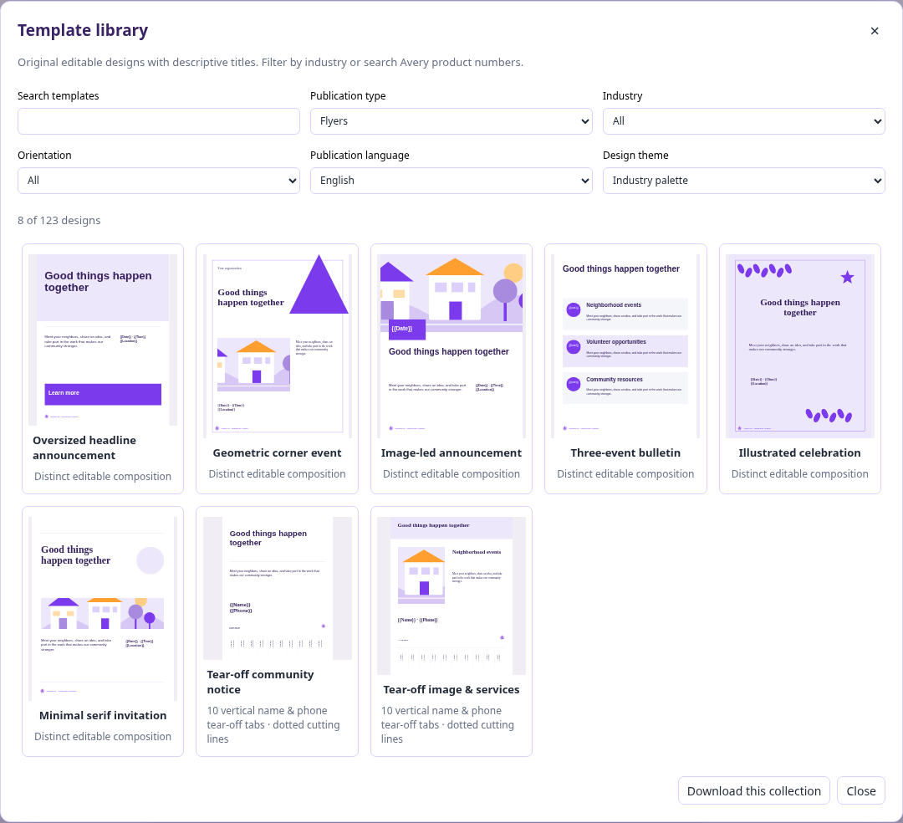

*Descriptive names identify the composition. Search and industry filters help narrow the selection.*

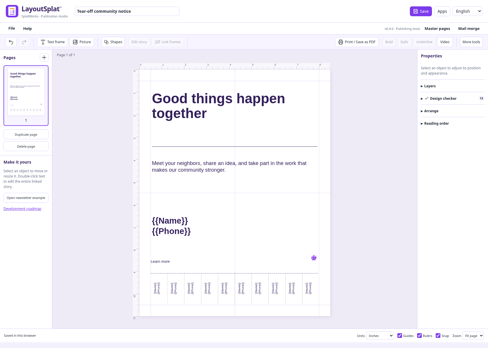

*Replace the name and telephone placeholders before printing or merging recipient data.*

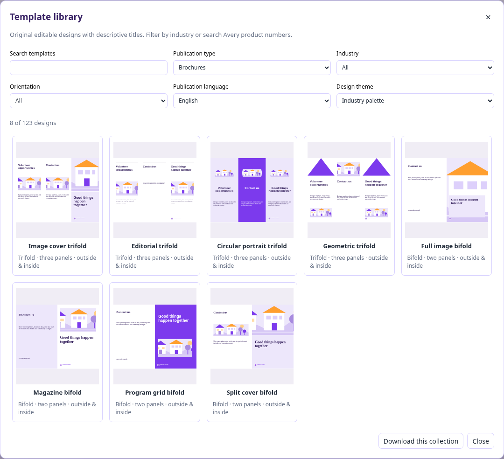

*Folded publications use panel layouts rather than a single design repeated in different colors. Equal Z-folds and roll folds with a narrower fold-in flap have different guides.*

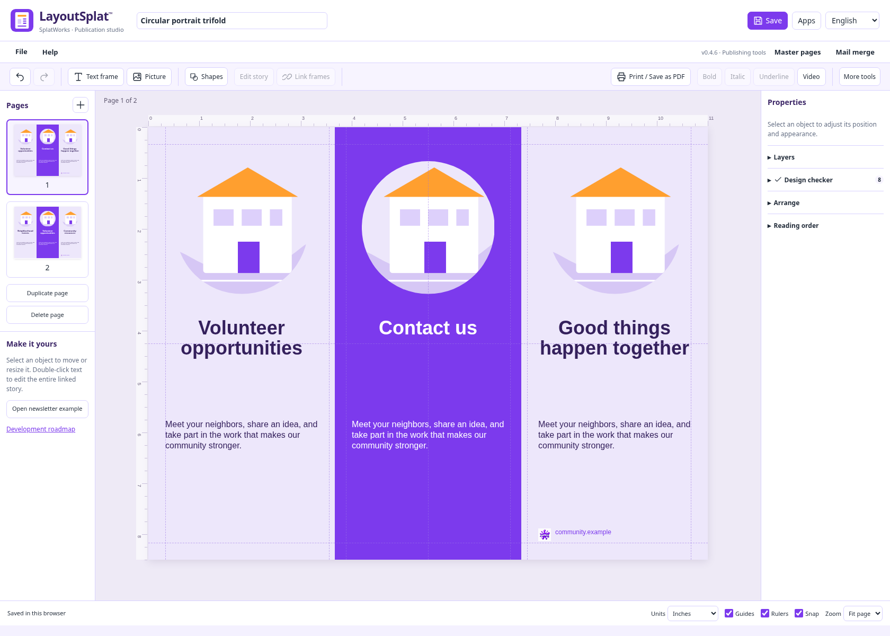

*Outside and inside pages can be edited separately. Replace the bundled example artwork and text with your own material.*

## 3. Paper size, margins, and layout guides

**File → Page layout** controls standard or custom page dimensions, orientation, margins, column and row guides, baseline spacing, bleed, and safe inset. Ruler origins can be adjusted, custom guides can be locked, and horizontal and vertical rulers can be shown separately. Facing-page preview supports spread planning.

Rulers support **inches, centimeters, picas, points, and pixels**. Changing units or zoom does not change physical page geometry. Guides, snapping, object edges, and midlines support precise alignment.

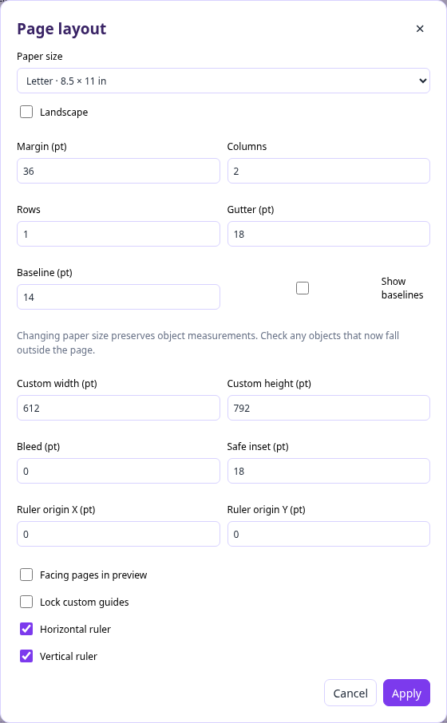

*Choose physical dimensions before preparing a print job. Bleed and safe inset serve different purposes: extra artwork beyond trimming and protected space inside the edge.*

## 4. Text frames, linked stories, and overflow

Create a text frame, then move and resize it on the page. Multiple frames can hold one story: **Shift-select boxes → context menu → Link text boxes**. A single selected frame can start a link-target action. Continue on next page adds a continuation frame.

Linked text flows through the frame chain. Unlinking splits the chain while retaining supported text and formatting. Columns, AutoFit, drop caps, overflow findings, alignment, and left-to-right/right-to-left text direction are available.

A frame is the container; the story is its content. Double-click a frame or use **Edit story** to work on the entire linked story.

## 5. Rich text editing and typography

The movable **Edit story** window includes bold, italic, underline, and paragraph alignment controls. Select words for inline formatting, drag the title bar to move the editor, and apply the changes. Supported mixed fonts, paragraph spacing, blank paragraphs, and indents survive editing and undo.

Text properties include font family, serif/sans-serif choices, size, weight, color, alignment, direction, line spacing, metrics kerning or no kerning, letter spacing/tracking, word spacing, horizontal text scale, and ligatures. WordArt and format painting provide additional text treatment and reuse.

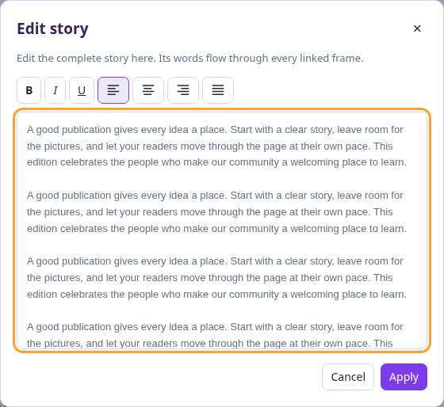

*The editor changes story content; linked frames determine where the text appears on the page.*

**File → Import → Fonts** accepts TTF, OTF, WOFF, and WOFF2. Local fonts can be embedded in native saves, portable HTML, and Pack and Go. Limits are 16 MB per font, 16 fonts, and 64 MB total. Use font files you are entitled to embed. For imported publications, load original fonts first so source family names and regular/bold/italic variants can be matched. Reports identify remaining substitutions.

Matching fonts improves text metrics. It does not guarantee that a different publishing engine will reproduce every line ending or advanced effect.

## 6. Shapes, drawing, grouping, and layers

The **Shapes** button groups rectangles, ellipses, lines, hexagons, triangles, arrows, stars, hearts, callouts, borders, and custom paths. Drawing, WordArt, border art, and picture watermarks provide additional design elements.

Use position/size fields, rotation, alignment, distribution, grouping, locking, duplication, and front/back stacking to arrange objects. Layer transparency sliders run from **0% transparent** to **100% transparent**. Picture wrapping is rectangular; arbitrary contour wrapping and wrapped drop-cap composition are not complete.

## 7. Context menus and replacing frame content

Right-click, supported Mac Control/Command-click, or Shift+F10 opens contextual actions. The selection determines the actions offered. Import or append text into a text frame, replace a picture or video in a media frame, link text boxes, and manipulate objects without rebuilding their placement.

The text-box import action keeps frame geometry and accepts TXT, Markdown, CSV/TSV text, HTML text, DOC, DOCX, ODT, and WriteSplat JSON. Supported source text formatting is retained. Document tables and source page layouts are not recreated by this action.

## 8. Pictures, media, and tables

Picture frames support fitting the whole image, filling the frame, stretching, supported crops, positioning, and replacement. Assets are embedded in native projects rather than depending on a private file path on the author’s computer.

Common browser images and local decoders cover formats including TIFF, HEIC/HEIF, PSD composites, and supported EPS/PS. Bundled FFmpeg attempts additional image/video containers. Actual codec and file variant determine support. Layered, multipage, HDR, and profile-sensitive material may be flattened. Media inputs are limited to 96 MB and raster pictures to 40 megapixels.

Videos can keep a poster image for print and play in the fixed-layout HTML edition. Print cannot reproduce motion or sound. Tables can be placed and styled as publication objects; importing a word-processing document into a text frame does not import its tables.

## 9. Shared whiteboard backgrounds and images

**File → Templates → Whiteboard backgrounds & images** opens **96 shared assets** from DrawSplat: classroom organizers, ScratchArt backgrounds, coloring pages, and animal pictures. Insert a locked page background, an ordinary picture, or fill a selected unlocked picture frame. The inserted asset is embedded, undoable, and replaceable. The standalone package includes the collection for offline use.

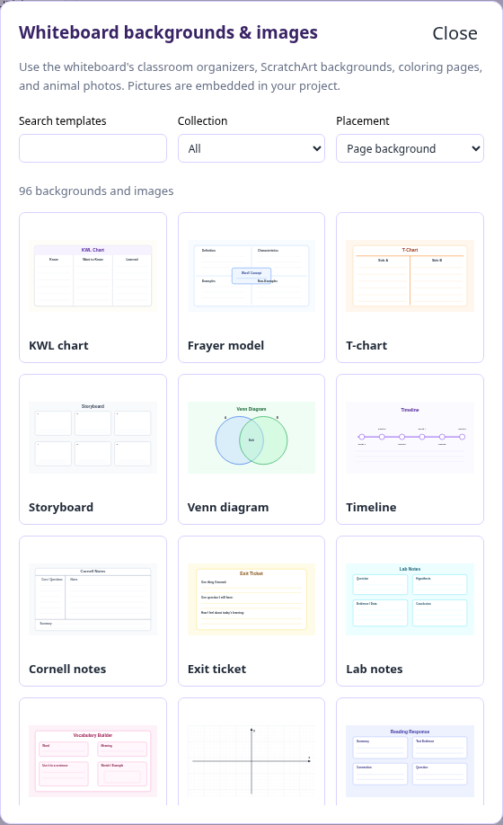

*The collection supports classroom publications without leaving the layout editor.*

## 10. Master pages and page numbers

Create a master from a selection or the whole page. Master objects appear behind ordinary page objects. Editing a master updates assigned pages. Apply masters to the current page, all pages, or left/right pages; hide inherited objects through local overrides and reset overrides when needed.

**Insert page numbers** supports `{page}` and `{total}`. Existing ordinary-page folios update when pages are added, duplicated, or deleted. Inserting again changes the format and covers new blank pages without duplicating existing folios. Editing or linking a folio makes it ordinary text. Folios moved into master artwork retain their format and resolve separately on each assigned page. Inserted, duplicated and deleted pages update the totals; local master overrides remain respected in previews and exports.

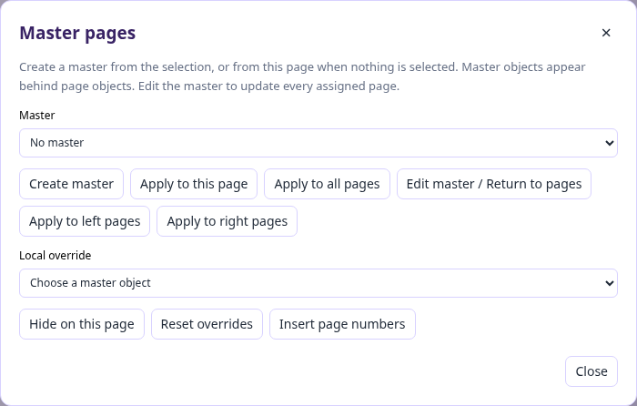

*Use masters for repeated branding and backgrounds, with local exceptions where needed.*

## 11. Avery labels and name badges

The label library offers **29 sheet geometries covering 127 Avery product codes**, including US Letter and A4. Cards lead with stock numbers and show physical measurements. Label/badge-type filtering helps find address, shipping, return, file-folder, insert badge, and adhesive badge layouts.

**File → Label sheet & printer alignment** sets horizontal/vertical printer offsets and the first unused label. Merge uses remaining positions before continuing onto new sheets. Print at actual size, with scaling and browser headers/footers disabled. Test on ordinary paper before using label stock.

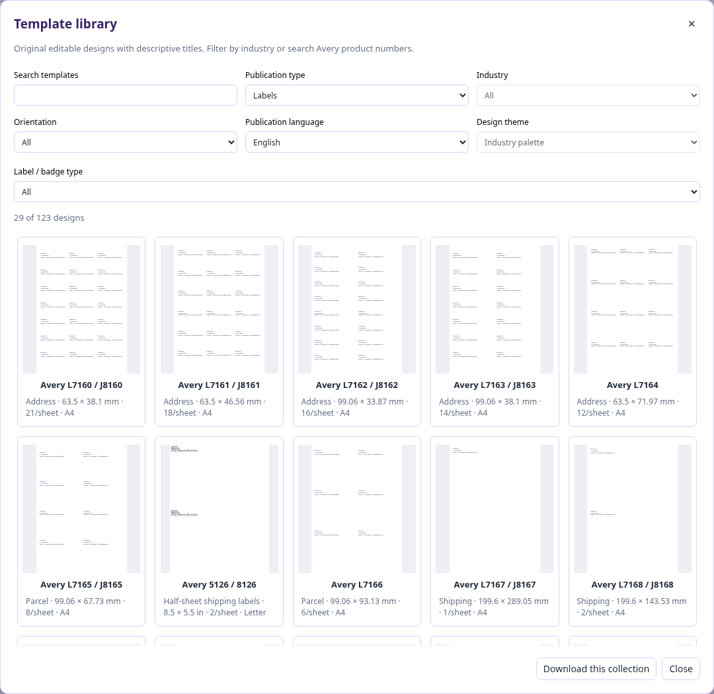

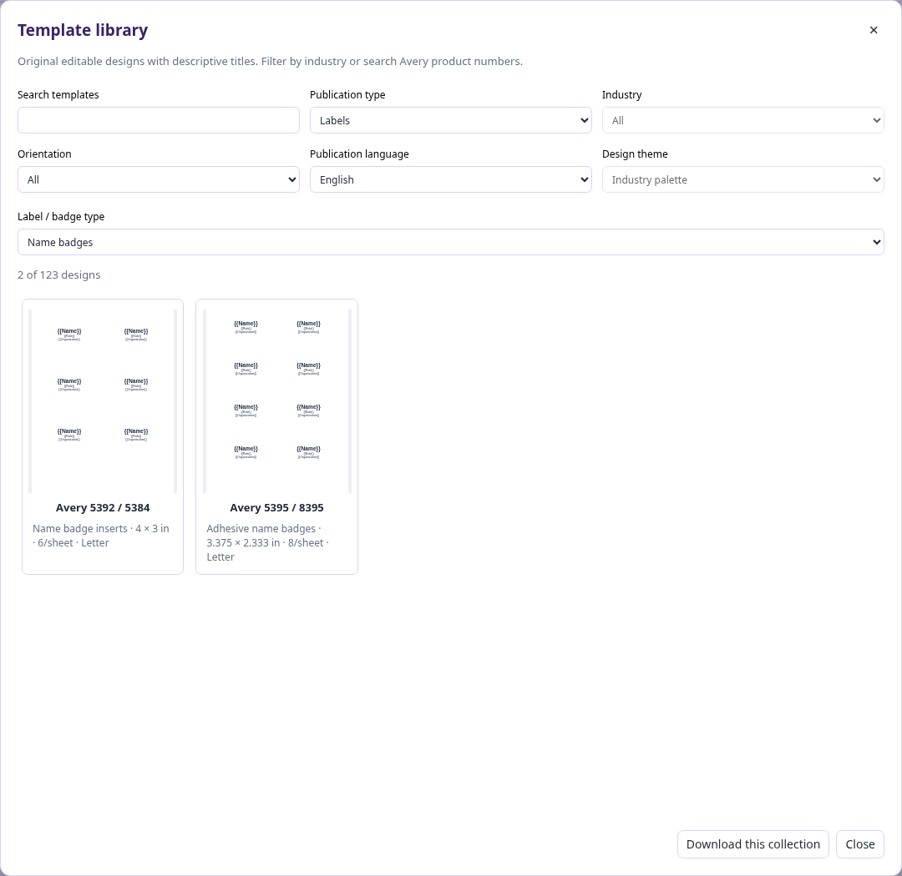

*Name badges share the labels section and have their own type filter.*

[Full stock list and measurements](https://splatworks.org/wiki/layoutsplat-labels.html). Product-code compatibility describes shared geometry; verify your actual stock and printer alignment.

## 12. Mail merge and data sources

Mail merge reads local **CSV, TSV, XLSX, GridSplat JSON, and ListSplat JSON**. Select a worksheet/table, map fields, filter records, preview, and review before generating personalized publications. Label batches span sheets and can skip used positions. Batches have bounds; recipient source tables are not saved in generated templates.

GridSplat formulas and number formatting use its calculation engine. ListSplat calculations use that app’s syntax, with hidden fields and archived records excluded. Formula errors stop the data source instead of silently printing wrong results.

## 13. Native projects: Open, Save, and JSON

**Open LayoutSplat project** restores a native JSON file, a `.layoutsplat` ZIP, or a LayoutSplat HTML export containing its native document payload. **Save project** downloads the portable package; native JSON is also available under Export. These are the preservation formats for editable LayoutSplat content.

**Import** converts another application’s content into the supported LayoutSplat model or page artwork. An interchange export is not a promise of lossless round-trip editing in another application. Keep the native project as the backup.

## 14. Publisher and other layout-program imports

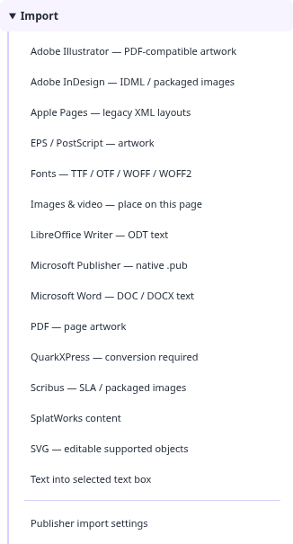

*The menu distinguishes page/artwork conversion from inserting formatted text into an existing frame. In v0.4.6 the QuarkXPress menu label still says “conversion required”; the bundled native decoder supports the legacy versions listed below.*

| Source format | Current behavior and boundary |
| --- | --- |
| Publisher PUB | Local WebAssembly decoder; supported editable text, shapes, embedded pictures, bitmap fills, crops, gradients, and drawing properties. Source bytes are retained. Native PUB export is available separately. Compare fonts, flow, links, and unsupported effects before printing. |
| Apple Pages | Legacy ZIP/XML documents: supported text, geometry, paths, styles, and embedded pictures. Modern IWA needs an alternate export. |
| QuarkXPress QXP/QXD/QXT | Native versions 3.1–4.1: supported text, frame geometry, and vectors. Newer versions require PDF/SVG interchange; linked stories, external pictures, text paths, and advanced effects need review. |
| Adobe InDesign | Supported IDML interchange is editable within its subset. Native INDD/INDT decoding is unavailable; use IDML, SVG, or PDF. |
| Scribus SLA | Supported editable objects and linked assets in packages; check the result in the target application. |
| Adobe Illustrator AI | PDF-compatible files become high-resolution page artwork. Supported PostScript artwork uses the local converter. |
| PDF | Supported pages become correctly sized high-resolution artwork; text on flattened pages is not editable. |
| EPS/PostScript | Local Ghostscript WebAssembly produces first-page flattened artwork for supported files. |
| SVG | Supported editable objects; complex effects may need flattening. |

Publisher, legacy Quark, and binary Word decoding do not require LibreOffice or document uploads. Publisher input is bounded to 32 MB with a 45-second cancellable worker timeout. Conversion failures are reported; unsupported native formats do not replace the current publication. See the [accuracy findings](https://splatworks.org/wiki/layoutsplat-import-accuracy.html) for tested behavior and remaining work.

## 15. Word, LibreOffice, and suite text exchange

Select an unlocked text frame, then choose **File → Import → Microsoft Word** for DOC/DOCX or **LibreOffice Writer** for ODT. Supported formatting includes source fonts/sizes/colors, bold/italic/underline, list numbering, alignment, paragraph spacing, leading, and indents. Default/named Word styles and OpenDocument automatic styles are resolved locally. Binary DOC has additional limitations for source line leading, fields, hyperlinks, pictures, and advanced layout. Append keeps supported existing paragraph formatting.

SplatWorks JSON import/export supports **WriteSplat stories, ShowSplat pages, and GridSplat/ListSplat tables**. WriteSplat exchange retains supported paragraph metrics, blank paragraphs, inline styles, links, and tab characters. List numbers become literal labels; custom tab-stop positions and font files do not transfer through that bridge. Complex formulas, charts, database relationships, and all cell styles are not reconstructed by suite conversion. Read the actual conversion report.

Ordinary cross-app project handoff opens the source app in an isolated draft; importing content into a layout is a different action.

## 16. Design checker and preview

**File → Design checker** scans supported layout findings, including overflow and page-boundary/print concerns. Review the itemized findings and preview the pages before output. Unsupported effects and source composition still need human comparison. A clean checker result is not commercial-printer or accessibility certification.

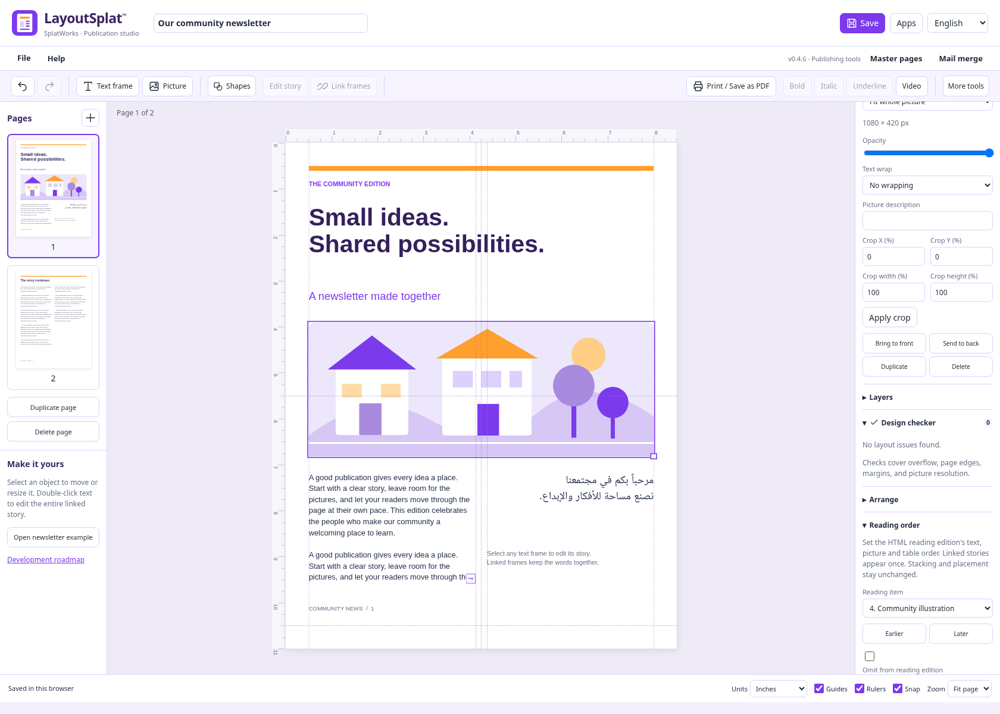

*The checker reports findings. Reading order controls determine the separate HTML reading sequence without moving the printed objects.*

## 17. HTML publishing and reading order

- **Fixed-layout HTML:** preserves page placement and supported media; includes a native payload for reopening in LayoutSplat.
- **HTML reading edition:** presents supported text, pictures, and tables in an adjustable sequence. Earlier/later and omission controls work independently of object stacking and geometry. Linked stories appear once. Supported rich spans, paragraphs, and links are retained; pale text colors are adapted for readability on the edition’s white page.

A reading edition is useful for flexible digital sharing. Its existence does not establish complete accessibility conformance.

## 18. PDF, image, and desktop interchange exports

**Print / Save as PDF** uses browser-shaped selectable text and vectors. The downloadable **PDF proof** is flattened artwork. PNG/JPEG exports support **150, 300, and 600 ppi**. As of v0.4.8, **PowerPoint PPTX** and **OpenDocument ODP** default to editable text boxes, pictures, native shapes and table cells. Rich text, supported paragraph settings, geometry, rotation and stacking are retained. Master artwork is copied to slides; columns and linked stories become independent visible text fragments. Font metrics and some effects may differ. Individual unsupported effects become picture objects and are identified in the conversion report. The optional **Page images** mode preserves the previous full-slide PNG output at the chosen resolution, including bleed. **Animated GIF** cycles selected pages in order, loops forever, and offers seconds per page and maximum pixel dimension. A single page makes a still GIF. GIF is limited to 24 million total frame pixels and ignores print settings. Embedded videos and animations use still previews in these three formats. SVG, IDML, Scribus SLA, native JSON, and suite-native content are also available.

**Publisher PUB** is an in-app Publisher 2000 binary export. Unicode text and basic rectangles/ellipses/lines are native editable objects. Other content, including tables, pictures, RTL text and decorative effects, becomes individual bitmap pictures on white backgrounds. Masters and linked text are flattened into page objects/fragments. Font files, live fields and precise source composition are not retained. All pages are included. Read the conversion report and inspect overlapping artwork. The embedded native LayoutSplat copy is restored only while the other Publisher streams remain unchanged; external edits trigger native decoding. LibreOffice reopening is verified; Microsoft Publisher itself is not yet tested. [Detailed limits](layoutsplat.md#publisher-pub-export).

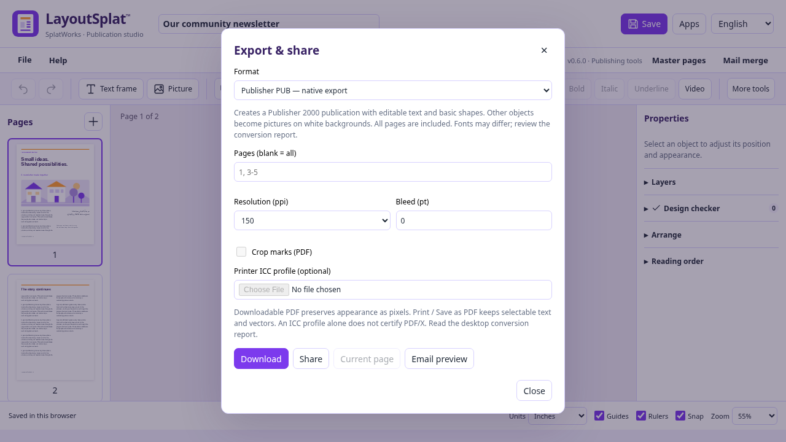

*Choose the resolution for bitmap fallbacks. Native text and shapes remain editable; the report identifies conversion limits.*

Visual exports support page ranges. Native and interchange project exports contain the publication. Interchange packages describe their conversion limits; validate them in the external application before production use.

## 19. Print preparation and Pack and Go

Print preparation includes bleed, crop marks, trim boxes, optional ICC output intents, and high-resolution proof images. **Pack and Go** gathers the native project, media, fonts, fixed/reading HTML, proof, checker findings, and printer instructions.

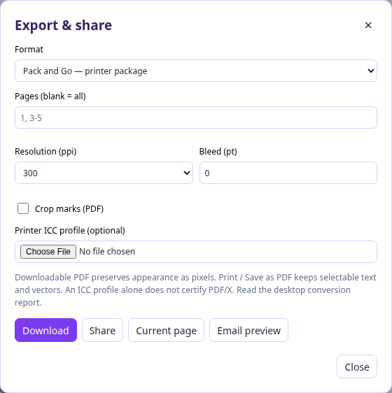

*An ICC output intent alone does not certify PDF/X. Use your printer’s specifications and review a proof.*

The optional desktop Ghostscript helper offers PDF/X-3 conversion plus independent structural checks for embedded font programs, Type3 glyph/mapping presence, transparency, uncharacterized RGB, active content, page boxes, and source/output/profile hashes. Reports record checker/converter versions. This helper is distinct from the browser’s bundled artwork decoder. Exhaustive PDF/X certification and external printer acceptance remain separate validation tasks.

## 20. Saving, recovery, offline use, and current limits

**File → Save to Google Drive** saves an editable native project copy. Download the `.layoutsplat` file from Drive and open it in LayoutSplat; Drive may display its internal `publication.json` and `README.txt` because the project is a ZIP archive. Keep the whole file for reopening. A real user-run upload/download/reopen succeeded on October 16, and the downloaded one-page publication passed archive and native-model validation. [Drive instructions](google-drive.md).

Browser drafts and recovery are convenient but depend on browser storage. Save a portable project. Drafts belong to the browser/device/domain; DrawSplat.org and SplatWorks.org do not share storage automatically.

**File → Clear saved browser data** clears this LayoutSplat workspace’s current publication, draft/recovery, and undo, then reloads a blank publication. Save first if you want to keep it. Other apps’ drafts and downloaded projects remain available.

Self-hosted/offline packages run over HTTP(S), including the supplied loopback launcher. Direct `file://` opening is unsupported. Keep the bundled fonts, workers, shared assets, and media runtime with the app. [Download packages and check their version](https://splatworks.org/pages/download.html).

The v0.4.6 validation run passed **52 browser workflows and 10 model checks**, with independent two-page and 100-page PDF checks. The 100-page test checks linked-story fragments, 800 body paragraphs, Letter geometry, and embedded fonts. A controlled 500-page layout regression checks reuse of unchanged stories and reflow of one edited story. These are specific regression results, not universal performance guarantees.

Remaining work includes closer source-program typography/flow fidelity, modern native formats, advanced wrapping/effects, broader large-document workloads, external application validation, and commercial print certification. The shipped features above should not be read as a claim that every Publisher feature or file variant is supported.

[Implementation reference](https://splatworks.org/wiki/layoutsplat.html) · [Roadmap and progress](https://github.com/mguhlin/drawsplat/blob/main/splatworks/layoutsplat/PROGRESS.md) · [Source and component notices](https://github.com/mguhlin/drawsplat/tree/main/splatworks/layoutsplat)

## 21. Ebooks and EPUB

Three original novel, guide and illustrated-story starters join the template library.
Open **File → Ebook tools** for metadata, a searchable outline, visual text editing,
and a reading preview with adjustable type and Paper/Sepia/Night themes.
Reading order adds H1–H6 heading levels for nested EPUB contents navigation.
Import supported EPUB 2/3 text and packaged pictures; export EPUB 3 as selectable
reflowable content or fixed-layout page pictures. [Ebook guide and limits](layoutsplat-ebooks.md).

## 22. Source ebook editing and composition (v0.7.0)

- XHTML/CSS and visual chapter editing, source preview, local link/fragment checks, retained footnotes and EPUB 3 navigation, and source-book export.
- Automatic English hyphenation with local patterns, manual/off controls and unchanged underlying story text.
- Alpha-contour picture wrapping with rotation, crop/mask sampling and reusable master pictures; six-point spacing and a manual refresh control.
- Linked-frame flow ordering controls, separate from artwork stacking and accessible reading order.
- WriteSplat round trips with embedded fonts, tab positions, hard breaks and nested list semantics.
- Corrected native SLA/IDML page geometry, font identifiers and text paths, independently checked in Scribus.

See [ebook instructions](layoutsplat-ebooks.md) and [verification evidence](layoutsplat-verification.md) for supported behavior and remaining external checks.
