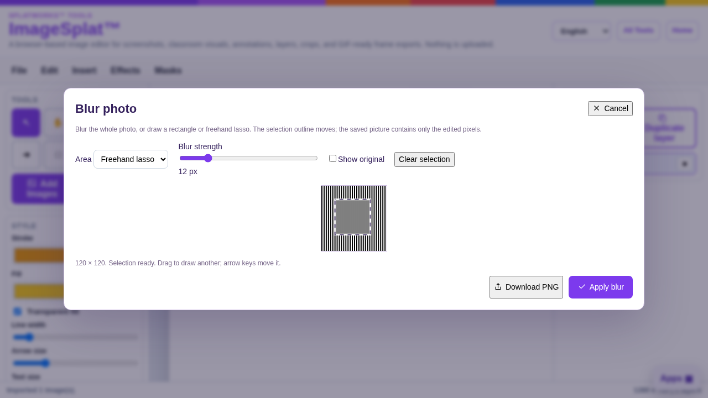
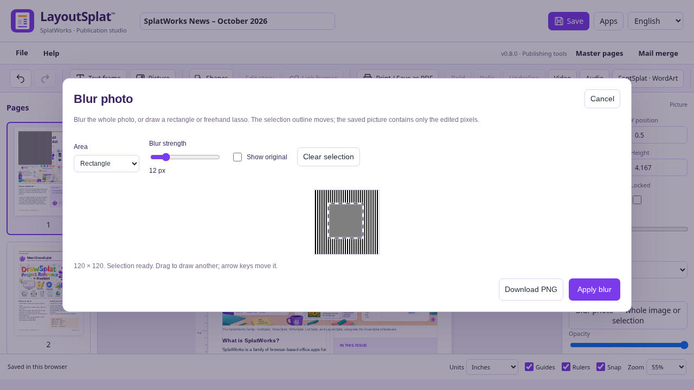

# Blur a whole photo or a selected area

ImageSplat and LayoutSplat share the same local photo-blur editor. Choose a still
image, then open **Effects → Blur photo · selection / lasso** in ImageSplat,
or **Blur photo — whole image or selection** in LayoutSplat's picture properties
or picture context menu.

Choose **Whole photo**, **Rectangle**, or **Freehand lasso**. For a partial blur,
drag over the image; a lasso closes its shape when you release the pointer.
The marching-ants outline shows the affected region. Drag again to redraw it,
or Clear selection. Arrow keys move a selection by one pixel; Shift moves by
10. Delete clears it. Adjust Blur strength and use Show original to compare.

**Apply blur** changes only the selected image. Rectangle/lasso mode requires
a drawn selection. Cancel leaves the image unchanged, and the app's Undo can
restore the earlier image after applying. LayoutSplat keeps the frame position,
size, rotation, fit and crop. Other objects that use the same source picture
keep their own image until you edit them.

**Download PNG** saves the edited picture directly. Blurring is baked into its
pixels, so it carries into image exports, native projects, HTML, PDF and EPUB;
it does not rely on a removable CSS filter. Native undo/history and separately
retained source editions still follow the app's normal editing behavior.

Large photos are proportionally resized to a maximum 16-megapixel working
image and a 16,384-pixel longest edge; the editor reports the working dimensions.
Processing stays on the device. LayoutSplat's audio/video players remain
separate from their print posters; choose a still photo for this feature.

