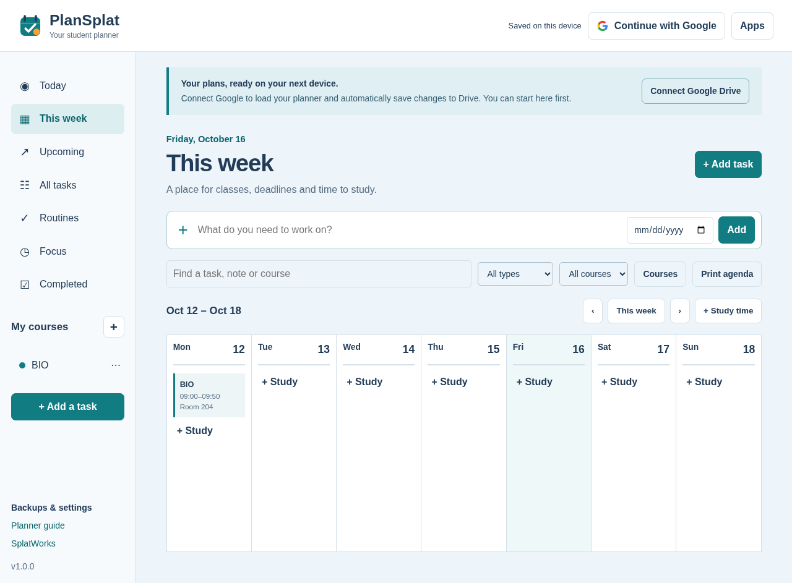

# PlanSplat student planner

[Open PlanSplat](../splatworks/plansplat/) to organize assignments, exams, projects, classes and study time. Start with a device draft or connect your Google account to load and automatically save your planner in Drive.

## Connect Google Drive

Choose **Continue with Google**, then **Continue with Google** in the connection window. Choose your account and allow access to files used with the app. PlanSplat finds your planner using its Drive properties, including on a new device; you do not need to find a file ID. If no planner exists, it creates one.

The status reports **Saved to Google Drive** after a completed sync. Edits first save on the device, then sync after a short pause. PlanSplat also checks for updates when you return to the tab and periodically while it is open. Google access tokens expire; choose **Reconnect Google** when prompted. Offline or unsynced changes remain in that account's device draft.

The main Drive file is `PlanSplat.plansplat.json`. A recovery file for each browser preserves that browser's checkpoint during overlapping saves from different devices. These files are updated, not duplicated for each edit. Keep the recovery files while their devices are in use. PlanSplat merges matching planner/recovery files and asks you to choose between conflicting edits. Simultaneous first-time connections can produce extra main files; the app merges them and retains the originals.

If you started a separate device-only planner, **Add device planner** explicitly merges it into the connected account. A device draft never silently moves to another Google account. Returning after a reload requires sign-in to load an account draft. **Account → Sign out** clears the active account view; select the device-draft removal option on a shared computer. Signing out does not delete your Google Drive files.

## Plan schoolwork

- **Add task** records an assignment, exam, project or personal task. Add a course, due date/time, day to work on it, estimated minutes, priority, notes, resource link and checklist.
- **Today** shows overdue work and work due or planned today. **Upcoming** lists future deadlines. **All tasks** includes undated work. Filter/search by title, notes, course or type.
- **Courses** stores class names, teacher, location and weekly meeting times. The course controls are available on phones through **Courses** above the task list.
- **This week** combines class meetings, task deadlines and study blocks. Choose **Plan time** on a task or **Study time** in the weekly view. Scroll the timetable horizontally on small screens.
- Check off a task to finish it. Recurring tasks create one next occurrence. Daily, weekdays, weekly and monthly options are supported; monthly dates clamp to the final day of a shorter month.
- **Routines** lets you choose weekly days and record check-ins. No public rankings or streak penalties are shown.
- Choose **Focus** on a task and start the timer. Adjust study/break durations, pause or reset. Completed study sessions appear in Focus. Timers use an absolute finish time to handle sleeping tabs; the next phase starts when you choose it.

Dates use your device's local calendar and time zone. A task deadline and a planned study date are separate fields. Review dates and class times after travel or a time-zone change.

## Backups and reminders

**Backups & settings** provides a native JSON backup, CSV task export/import, calendar export and reminder permission. Importing a native backup merges it with current work. Download a backup before clearing browser storage. **Recently deleted** restores removed tasks, courses, routines and study blocks.

CSV import accepts a Title, Content, Task Name, Task or Name column, common notes/description columns, ISO due dates, priorities and supported status values. Todoist/TickTick exports vary: review imported dates, recurrence, checklists and course assignments. CSV imports do not automatically recreate every feature from another service.

Calendar export creates an `.ics` file containing task deadlines as all-day events and study blocks at their scheduled times. Task due times appear in event descriptions. It does not connect to or grant access to Google Calendar. **Print agenda** prints the current task or weekly view.

Reminders and timer notifications require browser permission and an open app. Sleeping tabs, device sleep and browser settings can delay notifications. PlanSplat does not deliver push notifications after the app is closed.

## Privacy and limits

Planner content stays in this browser until you connect Drive or export a file. Connected saving sends planner data directly to Google's Drive API. Access uses the `drive.file` scope; Google tokens remain in tab memory and are excluded from backups. No Gmail, Classroom, contacts, whole-Drive or Calendar access is requested. No file sharing is enabled automatically.

Browser drafts and cached app resources are separate on each domain/device/profile. Use [Privacy](../privacy/) to export or clear origin-local data and control optional connections. School Google Workspace policy may block authorization. Follow the school's account and device requirements. See [Google Drive setup](google-drive.md) for exact-origin OAuth configuration on another host.

The first release has an English interface. Student-entered text supports Unicode. Limits include 10,000 task records, bounded history/checklists, and native planner files under 6 MB. Deleted records are retained as deletion markers for sync; they remain in exported backups until a future explicit compaction workflow. Drive recovery files contain the same personal planning data as the main file.

## Development and verification

[Development plan](../splatworks/plansplat/IMPLEMENTATION_PLAN.md) describes the release stages and future features. Browser tests exercise sign-in/API responses, file discovery, repeated updates, reconnect, device drafts and independent-device loading. Simulated API checks are separate from real personal/school-account acceptance; a real-account trial remains required before claiming that workflow verified.
