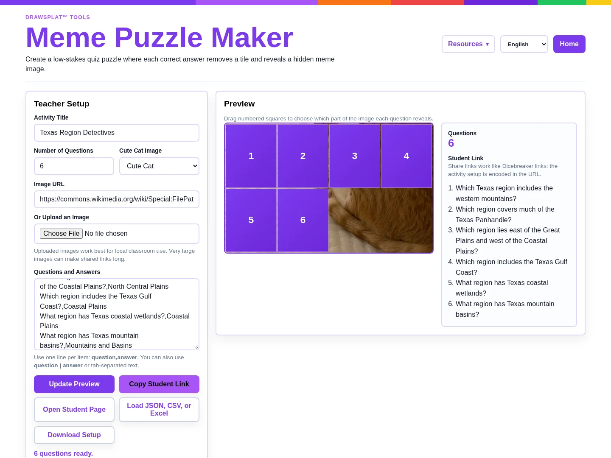

**Instructional Goal — Grade 4 Social Studies:** Students will locate Texas's four physical regions, describe their characteristics, and compare two regions using evidence from a map and region cards. This lesson addresses [Texas TEKS §113.15(c)(6)(A–B)](https://tea.texas.gov/laws-and-rules/sboe-rules-tac/sboe-tac-currently-effect/ch113a.pdf). Success means naming the regions accurately and explaining one similarity and one difference.

Ever watched students race to uncover a hidden picture? The purple tiles get their attention. I want to hear what happens before they click: can they explain *why* an answer fits? [DrawSplat Meme Puzzle](https://splatworks.org/solutions/memepuzzle/) reveals an image as students answer questions. Pair that retrieval practice with a paper evidence log, and a quick game becomes a useful geography check.

## Prepare the Puzzle

Here's a 35-minute lesson you can try. Gather a labeled Texas regions map, four short region cards, and a landscape image you created or have permission to use. Include landforms, climate, vegetation, and an example of economic activity on each card. Avoid treating a single photograph as representative of every place in a region.

In **Teacher Setup**, name the activity “Texas Region Detectives” and replace the sample questions. Start with six short-answer items: four region identifications and two characteristics. For example: “Which Texas region includes the state's western mountains?” Use “Mountains and Basins” as the expected answer. Preview the activity, test the accepted wording, and download its setup before class. Copy the student link only after checking it on a student device.

*Actual tool screenshot with Texas-region questions and the default preview image. Add your chosen landscape image before sharing.*

## Teach, Retrieve, Compare

**Launch, 5 minutes:** Show two contrasting Texas landscape photographs. Ask students what they notice and what they cannot determine from an image alone. Locate both areas on the map. Explain that today's target is a supported comparison.

**Investigate, 8 minutes:** Partners read the region cards and mark the four regions on a paper map. One student locates evidence; the other records it. Switch responsibilities halfway through. Model the distinction between a landform and a climate characteristic.

**Retrieve, 12 minutes:** Partners play the puzzle. Before entering each answer, both write a prediction and point to supporting evidence. When an answer fails, check spelling and expected wording before deciding it reveals a geography misconception. Record the corrected idea and its source. Let the image reveal provide encouragement while you listen for reasoning.

**Compare, 7 minutes:** Each pair selects two regions and completes: “Both regions ___, but ___ differs because ___.” Students must identify a specific card detail for each claim. Invite another pair to challenge a vague comparison and suggest a revision.

## Check Learning and ELE Alignment

**Exit ticket, 3 minutes:** Individually locate two regions on a blank map and write one supported similarity and difference. Assess location accuracy, characteristic accuracy, and evidence. Puzzle completion alone cannot show mastery.

The [TCEA Essential Learning Expectations](https://mglearn.github.io/eles) connect through **S3.1**, effective teamwork, demonstrated by shared responsibilities; **S3.2**, clear communication, demonstrated by the comparison; and **S4.2**, monitoring progress, demonstrated by the correction log. These are lesson-planning alignments, not an official TCEA endorsement.

Read cards aloud, offer bilingual vocabulary and comparison stems, and allow pointing before oral explanation. With one device, project the puzzle and collect individual paper predictions. Keep the same evidence requirement either way.

SplatWorks and DrawSplat are available at no charge for anyone to use.
